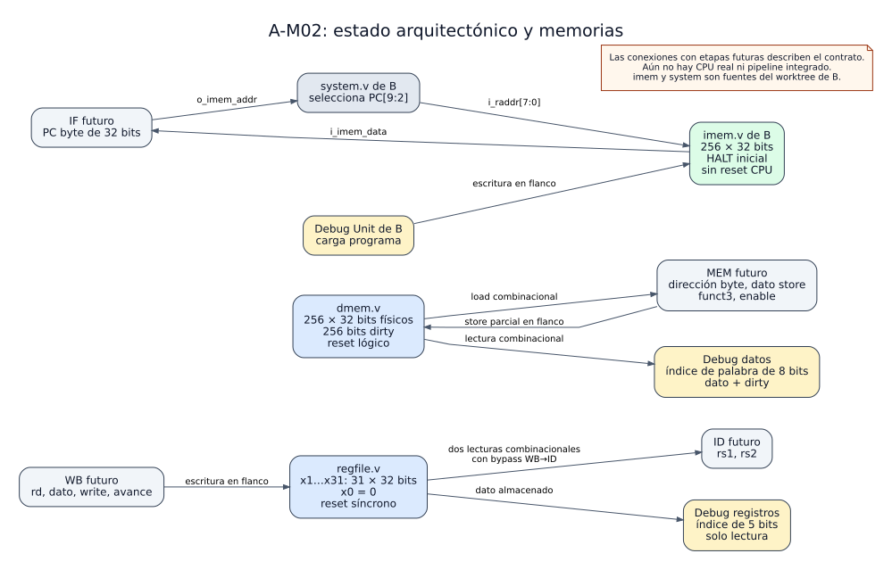
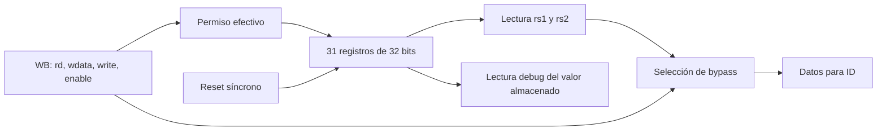
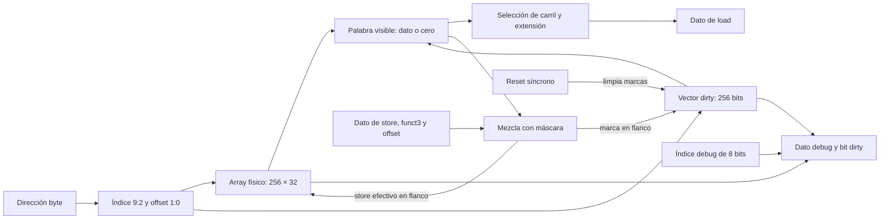

# 02 — Estado y memorias

> Nota de reorganización: este documento conserva evidencia y comandos históricos. Los helpers `check_*` de A se retiraron y ya no se usa `--companion`; las rutas y comandos vigentes están en [organización del proyecto](organizacion.md).

Esta guía describe el milestone **A-M02 (issues A-07 a A-11)**. Añade almacenamiento y puertos de lectura para el futuro CPU RV32I: el banco de registros, la memoria de datos y el acuerdo de conexión con la memoria de instrucciones de B. Cada bloque se comprobó de forma aislada; todavía no existe un CPU de A que los instancie juntos.

[Ver SVG ampliable](../diagramas/02_estado_y_memorias.svg) · [Ver fuente PlantUML](../diagramas/02_estado_y_memorias.puml)

**Cómo leer el diagrama:** `regfile.v` y `dmem.v` son RTL de A. `imem.v` y `system.v` son de B y permanecen en su propio worktree. Los bloques «futuro» muestran el contrato de conexión previsto, no instancias existentes. El testbench `tb_imem_bridge` comprueba hoy el enlace entre el stub y la memoria externa.

## 1. Qué significa guardar estado en estos bloques

La lógica combinacional de [A-M01](01_combinacionales.md) calcula salidas a partir de entradas actuales. Aquí aparecen datos que sobreviven a un flanco de reloj: registros arquitectónicos, palabras de memoria y marcas `dirty`. Las lecturas de los tres bloques son combinacionales; las escrituras ocurren en el flanco positivo. Por eso, después de cambiar una dirección de lectura, el dato se puede observar sin esperar un nuevo flanco; una escritura se hace visible al almacenamiento después del flanco.

Los tres bloques usan direcciones distintas. `regfile` selecciona uno de 32 registros con **5 bits**. `dmem` recibe una dirección **byte** de 32 bits y usa `[9:2]` como índice de una de 256 palabras. Su puerto debug recibe directamente ese índice de **8 bits**. `imem` recibe un índice de palabra de **8 bits**; `system.v` de B convierte el PC byte en ese índice usando `[9:2]`. Esta distinción evita desplazar dos veces una dirección o confundir los offsets de byte de un load/store con el índice debug.

## 2. Banco de registros: `regfile.v` (A-07)

`regfile` almacena físicamente `x1…x31`, 31 palabras de 32 bits. `x0` no tiene celda: cualquier lectura de `x0` entrega cero, y una escritura dirigida a `x0` se ignora. `i_rs1` e `i_rs2` ofrecen dos lecturas combinacionales para ID; `i_dbg_addr` ofrece una tercera lectura de inspección, también combinacional.

| Condición | Resultado |
|---|---|
| `i_reset=1` en un flanco | Se borran `x1…x31`, incluso con `i_en=0`; tiene prioridad sobre la escritura. |
| `i_en && i_reg_write && i_rd!=0 && !i_reset` | `i_wdata` se guarda en `i_rd` en el próximo flanco. |
| Lectura ID de `i_rd` durante esa escritura efectiva | Se entrega `i_wdata` mediante bypass WB→ID, antes del flanco. |
| Lectura debug de `i_rd` antes del flanco | Se entrega el valor **almacenado** anterior; debug no usa ese bypass. |
| `i_en=0` o `i_reg_write=0` | No hay escritura ni bypass de una operación inefectiva. |

La implementación genera un proceso secuencial por registro físico, de modo que cada palabra almacenada tiene un único lugar de escritura. El bypass es una selección combinacional de salida y no duplica el almacenamiento. El futuro CPU deberá conectar `i_en` con su permiso de avance y `i_reg_write` con WB válido.

## 3. Memoria de datos: `dmem.v` (A-09 y A-10)

`dmem` contiene 256 palabras físicas de 32 bits, equivalentes a 1024 bytes direccionables. El índice es `i_addr[9:2]`; los bits `[1:0]` eligen el carril dentro de la palabra. Los bits `[31:10]` se ignoran según el contrato: por ejemplo, las direcciones byte `0` y `1024` señalan la misma palabra. No hay detección de desalineación en este módulo; el comportamiento está definido por el carril elegido dentro de una palabra.

| `i_funct3` | Operación | Dato devuelto o escrito |
|---|---|---|
| `000` | `lb` / `sb` | Byte seleccionado; `lb` extiende signo. |
| `001` | `lh` / `sh` | Mitad seleccionada por `i_addr[1]`; `lh` extiende signo. |
| `010` | `lw` / `sw` | Palabra completa. |
| `100` | `lbu` | Byte con extensión por ceros. |
| `101` | `lhu` | Mitad con extensión por ceros. |
| Otras | No soportada | Load devuelve cero; store no escribe. |

Para un store parcial, la lógica combinacional construye una máscara y desplaza los bits de `i_store_data` al carril correspondiente. El dato nuevo combina los bits conservados de la palabra antigua con los bits del store. La escritura efectiva requiere `i_en && i_we && !i_reset` y un tamaño de store válido. `r_mem` y `r_dirty` se actualizan en procesos secuenciales distintos.

### Reset lógico y marcas `dirty`

Un vector de 256 bits indica qué palabras han recibido una escritura efectiva. Después de reset, las palabras limpias se leen como cero aunque sus celdas físicas contengan valores antiguos o desconocidos. El reset **borra `dirty`, no el array físico**; por eso evita una limpieza de 8192 bits en un solo flanco. Un `sb` o `sh` sobre una palabra limpia mezcla sobre cero. Una escritura de valor cero también deja la marca `dirty=1`.

El reset es síncrono y prioritario aun con `i_en=0`; una petición de store durante reset no modifica la memoria. El puerto debug entrega `o_dbg_dirty` y `o_dbg_data` de la palabra indicada por `i_dbg_addr`, sin necesidad de habilitar el CPU. Para una palabra limpia, debug entrega dato cero y dirty cero. Cambiar el índice debug o leer mientras el CPU está pausado no altera el estado.

### Ejemplo de stores parciales

Tras reset, la palabra 255 está limpia y se lee como `0x00000000`. Un `sb` en offset 1 con `0xAA` deja `0x0000AA00`. Un `sh` en la mitad superior con `0xBEEF` deja `0xBEEFAA00`; un `sb` en offset 0 con `0x44` deja `0xBEEFAA44`. La marca dirty queda a 1 durante toda la secuencia. Esta secuencia está cubierta con resultados constantes por `tb_dmem_dirty`.

## 4. Memoria de instrucciones externa: acuerdo A-08

La memoria de instrucciones pertenece a B. `imem.v` tiene 256 palabras de 32 bits, lectura combinacional, escritura síncrona por la Debug Unit, contenido inicial HALT (`0x00000073`) y ningún puerto de reset CPU. `system.v` mantiene una sola instancia y conecta el PC byte completo del CPU mediante `PC[9:2]` al índice de lectura. El dato vuelve al puerto `i_imem_data` del CPU. La carga del programa puede continuar mientras el CPU está en reset; el reset CPU no borra instrucciones.

El arnés `tb_imem_bridge` usa `cpu_stub.v` e `imem.v` reales de B desde un worktree separado. Verifica PC, wrap del índice de 256 palabras, escritura con CPU pausado y persistencia de instrucciones frente a reset. El stub **no ejecuta** `i_imem_data`; la captura de instrucciones por IF/ID se verificará al crear el CPU real. No se copió el RTL de B al árbol de A ni se duplicó `imem`.

## 5. Entregables del milestone

| Issue | Entrega principal | Prueba |
|---|---|---|
| A-07 | `regfile.v`, bypass WB→ID y puerto debug. | `tb_regfile` |
| A-08 | Contrato de una `imem` externa, bridge de A con fuentes de B. | `tb_imem`, `tb_imem_bridge` |
| A-09 | `dmem.v` con loads y stores por byte, mitad y palabra. | `tb_dmem` |
| A-10 | Reset lógico, dirty y lectura debug exhaustiva. | `tb_dmem_dirty` |
| A-11 | Regresión conjunta y síntesis aislada de los tres tops. | Runner `tbs`, dos TB externos, `synth_ooc` |

Los RTL y TB de A están en [`VIVADO/TP_FINAL`](../../VIVADO/TP_FINAL/). Las fuentes de A y sus TB figuran en `TP_FINAL.xpr`; el bridge está en *Simulation Sources* y depende de las fuentes del worktree de B hasta la integración. El runner [`tools/run.py`](../../tools/run.py) registra los casos en [`tools/tbs.py`](../../tools/tbs.py). La [evidencia A-M02](../validation/A-M02.md) conserva comandos, versiones, resultados de simulación y recursos de síntesis.

Desde `Practico/TPs`, la regresión local se ejecuta con `python3 TP3_FINAL/tools/run.py tbs`. La regresión de cierre incluye también las fuentes externas de B: `python3 TP3_FINAL/tools/run.py test --companion ../TPs-companion`. La síntesis aislada se invoca con `VIVADO=/ruta/a/vivado python3 TP3_FINAL/tools/run.py synth_ooc regfile`, cambiando el top por `dmem` o por `imem --companion ../TPs-companion`.

## 6. Alcance de la verificación

Los TB comprueban lectura y escritura, reset y pausa, bypass y acceso debug concurrente. La síntesis aislada muestra qué estructuras infiere Vivado y sus recursos para la parte Basys3. No mide el timing del sistema completo ni sustituye la prueba del CPU real. Las conexiones finales de `regfile` y `dmem` con WB/MEM, y la recepción de `i_imem_data` por IF/ID, pertenecen a las siguientes issues. Los contratos entre A y B se mantienen en [interfaz_cpu.md](cpu_interfaz.md) y las decisiones locales en [decisiones.md](cpu_decisiones.md).

## 7. Integración posterior

A-M03 ya conecta estos bloques con el CPU real. La [guía 03 — Pipeline base](03_pipeline_base.md) describe IF/ID/EX/MEM/WB, el retorno de writeback, los permisos efectivos, debug y la prueba de cierre sin riesgos. Las menciones a etapas futuras de esta guía corresponden al estado al cerrar A-M02.
