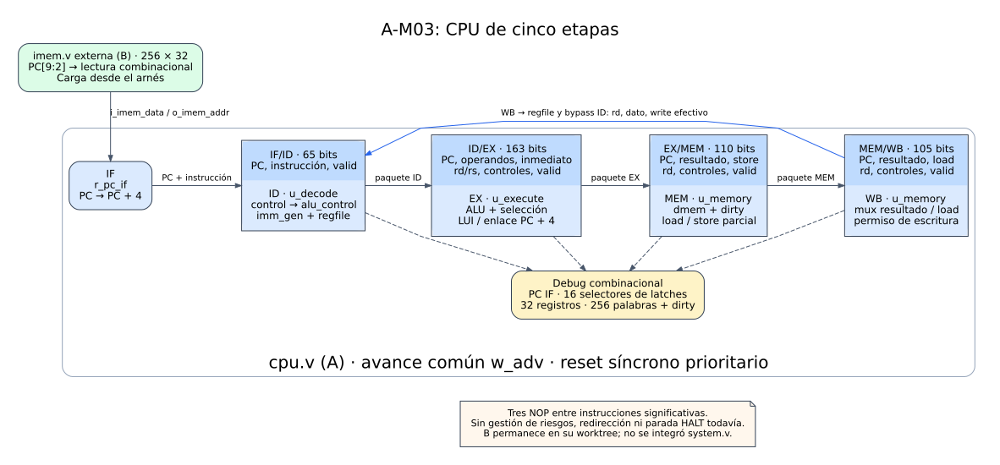
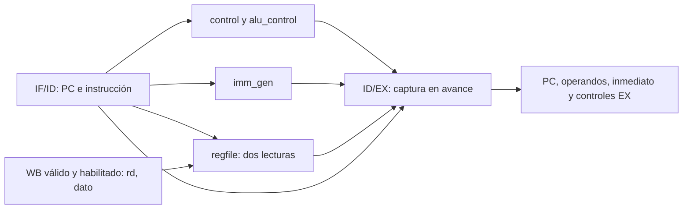
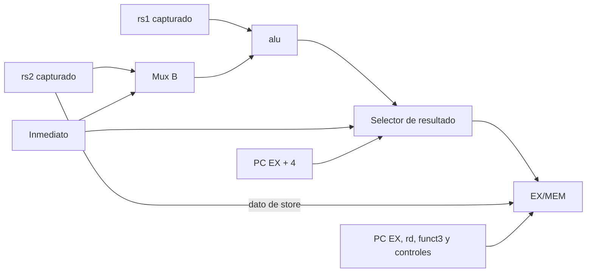
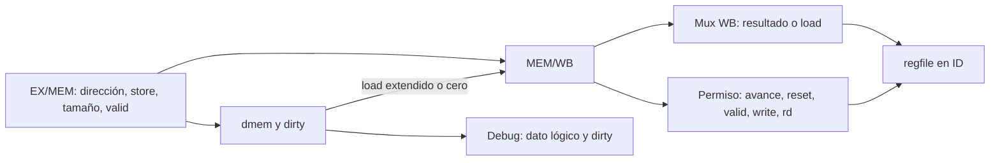

# 03 — Pipeline base de cinco etapas

Estado posterior: A-29 agregó HALT explícito a los programas y actualizó sus bancos. Los resultados de este informe conservan la evidencia histórica del milestone; el flujo vigente está en [07 — HALT y congelamiento](07_halt_y_congelamiento.md) y en el [README de programas](../../programs/README.md).

Esta guía describe el milestone **A-M03 (issues A-12 a A-17)** y su cierre local. El CPU conecta IF, ID, EX, MEM y WB: recibe instrucciones de una imem externa, calcula resultados, escribe memoria y devuelve resultados al banco de registros. El programa de cierre ejecuta las 10 operaciones R, las 9 I-ALU, LUI y cargas/stores sin riesgos, con resultados calculados por separado. La evidencia reproducible está en [A-M03](../validation/A-M03.md) y [A-17](../validation/A-17.md).



[Ver SVG ampliable](../diagramas/03_pipeline_base.svg) · [Ver fuente PlantUML/Graphviz](../diagramas/03_pipeline_base.puml)

**Cómo leer el diagrama:** los bloques azules son RTL de A ya instanciado en `cpu.v`. Los cuatro registros separan las etapas. La flecha de retorno WB lleva el resultado y su permiso efectivo al banco de registros de ID; también alimenta el bypass WB→ID. El bloque verde es `imem.v` de B, utilizado desde su worktree. El bloque amarillo representa lecturas combinacionales de debug. El diagrama muestra el CPU y el arnés de memoria; `system.v` y la Debug Unit de B todavía no forman parte de esta prueba.

## 1. Organización y avance

La jerarquía implementada es:

```text
cpu
├── r_pc_if
├── u_if_id: if_id
├── u_decode: decode_stage
│   ├── u_control: control → alu_control
│   ├── u_imm_gen: imm_gen
│   ├── u_regfile: regfile
│   └── u_id_ex: id_ex
├── u_execute: execute_stage
│   ├── u_alu: alu
│   └── u_ex_mem: ex_mem
└── u_memory: memory_stage
    ├── u_dmem: dmem
    └── u_mem_wb: mem_wb
```

`memory_stage` contiene tanto MEM como el mux y los permisos combinacionales de WB. Esa agrupación de módulos no combina los ciclos de ambas etapas: `mem_wb` conserva la frontera temporal. Los bloques combinacionales se reutilizan de [A-M01](01_combinacionales.md); el banco y la memoria de datos vienen de [A-M02](02_estado_y_memorias.md).

El reloj es común. `w_adv = i_en && !o_halted` habilita PC, cuatro registros y efectos arquitectónicos. En este milestone `o_halted=0`, por lo que el permiso sigue a `i_en`. Una pausa mantiene los paquetes y bloquea escrituras; el reloj físico puede seguir oscilando. Por eso las latencias se expresan en **avances habilitados**, no en cantidad de flancos físicos. Reset es síncrono y prioritario incluso con enable cero.

## 2. Qué conserva cada registro (A-12)

| Registro | Datos y metadatos almacenados | Controles almacenados | Total |
|---|---|---|---:|
| IF/ID | PC 32, instrucción 32 | valid 1 | 65 bits |
| ID/EX | PC 32, rs1_data 32, rs2_data 32, inmediato 32, rd/rs1/rs2 de 5 cada uno, funct3 3, alu_op 4 | alu_src_b, mem_read, mem_write, mem_to_reg, reg_write, branch, jump, jalr, lui, halt, uses_rs1, uses_rs2 y valid | 163 bits |
| EX/MEM | PC 32, resultado 32, store_data 32, rd 5, funct3 3 | mem_read, mem_write, mem_to_reg, reg_write, halt y valid | 110 bits |
| MEM/WB | PC 32, resultado 32, load_data 32, rd 5 | mem_to_reg, reg_write, halt y valid | 105 bits |

Cada campo almacenado tiene su propio `always @(posedge i_clock)`; no se reúne todo el paquete en un único proceso. Los registros se exponen como `o_*` y el CPU los conecta mediante `w_*_id/ex/mem/wb`. El PC de IF vive directamente como `cpu.r_pc_if`. No hay otro banco de almacenamiento para el dump.

La prioridad común es **reset > conservar sin enable > flush > stall > captura**. Reset pone todos los campos a cero. Flush invalida y limpia controles pero conserva PC, datos e identificadores. Stall conserva el contenido. Una captura con valid cero puede guardar datos y metadatos, pero anula los controles de efectos. En IF/ID, que no tiene controles separados, flush conserva PC/instrucción e invalida. Los puertos flush/stall están disponibles y probados aisladamente; el CPU base los conecta a cero.

`valid` significa ocupación del paquete. No significa que el encoding sea soportado. Decode usa `valid_id && valid_instr` para habilitar controles y consumo de operandos, pero conserva la ocupación en ID/EX. Tampoco se fuerzan datos de debug a cero por valid: se deben interpretar junto a sus flags. La política final de retiro de instrucciones ilegales no se agrega en A-M03.

## 3. IF: PC y recepción de instrucciones (A-13)

IF mantiene un PC byte de 32 bits y calcula `PC+4`. `o_imem_addr` y `o_dbg_pc` muestran ese PC completo. La imem externa recibe únicamente `[9:2]`, índice de sus 256 palabras; su salida combinacional entra en `i_imem_data`. En cada avance, IF/ID captura juntos el PC actual y la instrucción correspondiente y se vuelve válido. Simultáneamente el PC de IF pasa al siguiente valor.

Aunque imem hace wrap de índice, el PC y los metadatos mantienen los 32 bits: después de 1024 bytes se vuelve a leer la palabra 0 sin volver el PC a cero. Reset del CPU pone el PC en cero e invalida el pipeline, pero no borra la imem de B. El arnés puede cargar programa con el CPU en reset o pausado. Hay una sola instancia externa de imem; no se incorporó una copia a A.

## 4. ID: decode, operandos e inmediatos (A-14)

`decode_stage` reúne `control`, `imm_gen`, `regfile` e `id_ex`. `control` instancia a su vez `alu_control`; no se duplica el decoder de operaciones en el CPU. La instrucción de ID selecciona rs1, rs2 y rd, genera el inmediato con signo/formato apropiado y produce controles. ID/EX captura esos valores junto al PC de esa misma instrucción.

El banco ofrece dos lecturas combinacionales de operandos y una de debug. x0 siempre vale cero; se almacenan únicamente x1…x31. Si WB escribe efectivamente un registro que ID lee en ese ciclo, el bypass WB→ID entrega el valor de WB antes del flanco. Debug muestra el contenido almacenado. Ese bypass local del banco ya existía en A-M02; el forwarding hacia EX aún no se implementa.



La pausa deshabilita escritura y bypass de una operación inefectiva. Al reanudar, el WB pendiente puede escribir y alimentar ID en el mismo flanco. Las señales de consumo `uses_rs1/uses_rs2` quedan guardadas para los siguientes milestones de riesgos y no se serializan en info.

## 5. EX: ALU, destino y resultado de enlace (A-15)

`execute_stage` selecciona como operando A el rs1 capturado y como B el rs2 o el inmediato según `alu_src_b`. La ALU calcula ADD, SUB, SLL, SRL, SRA, AND, OR, XOR, SLT y SLTU. El selector final entrega `PC_ex+4` para JAL/JALR, el inmediato para LUI y la salida de ALU para las demás operaciones.

Ese resultado tiene distintos significados según el control: dato aritmético, dirección efectiva de load/store o dirección de retorno. El rd se conserva hasta WB. El dato de store se toma de rs2 **antes** del mux de inmediato; de esa manera una dirección `rs1+offset` no sustituye el contenido que se quiere guardar.



Los nombres `w_rs1_fwd_ex/w_rs2_fwd_ex` reservan el punto de conexión futuro; hoy son conexiones directas de los operandos capturados. Calcular el enlace de salto no implica redirigir fetch. Comparación de branches, destino/toma efectivos, flush y redirección permanecen en las issues posteriores.

## 6. MEM y WB: memoria y efectos (A-16)

MEM usa `result_mem` como dirección byte, `store_data_mem` como dato y funct3 como tamaño. `dmem` conserva su contrato: 256 palabras físicas, little endian, wrap por `[9:2]`, selección de carril por bits bajos y memoria lógica limpia igual a cero. Soporta LB/LBU/LH/LHU/LW y SB/SH/SW. Dirty registra escrituras aun si guardan cero. Reset limpia las marcas, no el array físico; un store parcial sobre una palabra limpia mezcla sobre cero.

El permiso de store del wrapper es `i_en && !i_reset && valid_mem && mem_write_mem`; dmem además filtra tamaños no soportados y aplica su enable/reset. Un load válido captura el dato extendido en MEM/WB; las demás instrucciones capturan `load_data=0`. La dirección/resultado se conserva por separado para inspección.

En WB el mux elige `load_data_wb` cuando `mem_to_reg_wb=1`, o `result_wb` en otro caso. El permiso de regfile exige avance, ausencia de reset, valid WB, reg_write WB y rd distinto de cero. El permiso efectivo y el valor seleccionado regresan a decode. Se mantienen las protecciones locales del banco.



Llegar a WB y escribir el banco son momentos diferentes. Después de un flanco, MEM/WB ya expone su nuevo paquete; ese paquete escribe regfile en el siguiente flanco habilitado. La prueba observa el permiso y dato previos al flanco, y compara el contenido almacenado después de las actualizaciones NBA.

## 7. Inspección del pipeline

La interfaz pública se conserva exactamente mediante el `cpu_ports.vh` original de B. Los selectores del dump leen los paquetes actuales:

| Selector | Palabra |
|---:|---|
| 0 / 1 | PC ID / instrucción ID |
| 2 | PC EX |
| 3 / 4 | rs1 / rs2 capturados en EX |
| 5 / 6 | inmediato EX / info EX |
| 7 / 8 / 9 / 10 | PC MEM / resultado MEM / dato store MEM / info MEM |
| 11 / 12 / 13 / 14 | PC WB / resultado o dirección WB / dato load WB / info WB |
| 15 | Flags: valid ID, EX, MEM y WB en bits 0…3; los demás bits hoy son cero. |

Info ocupa rd `[4:0]`, rs1 `[9:5]`, rs2 `[14:10]`, funct3 `[17:15]`, alu_op `[21:18]`, alu_src_b 22, mem_read 23, mem_write 24, mem_to_reg 25, reg_write 26, branch 27, jump 28, jalr 29, lui 30 y halt 31. EX expone los campos completos; MEM aplica presencia `0x8783801F` y WB `0x8600001F`, con los campos ausentes en cero. Son palabras combinacionales construidas a partir de los flops existentes.

`o_dbg_pc` muestra IF. Debug de registros usa índice de 5 bits y memoria usa índice de **palabra** de 8 bits, distinto de la dirección byte de un load/store. Ambos siguen disponibles con el CPU pausado y no provocan escrituras. Halted, stall, take y stop_fetch de los flags se habilitarán al implementar sus funciones; no se simulan como ya disponibles.

## 8. Programa de cierre y seguimiento temporal (A-17)

El [programa y sus expectativas](../../programs/README.md) contienen 36 instrucciones significativas, tres NOP después de cada una y relleno hasta las 256 palabras de imem. Se usan x1=−16, x2=3 y LUI x3=`12345000`, con resultados positivos, negativos, signo/cero en loads y comparación signed/unsigned. Hay cuatro stores, siete loads, una suma de resultados cargados, un intento de escribir x0 y un marcador x31=`000005a5`.

Los valores de referencia son constantes calculadas por separado. Por ejemplo, SRA de −16 por 3 produce −2, mientras SRL produce `1ffffffe`; el byte `f0` leído con LB produce `fffffff0`, con LBU produce `000000f0`. Los stores parciales forman `fff0f000` en la palabra 1. La palabra 255 recibe cero y queda sucia. El TB compara los 32 registros, las 256 palabras lógicas y los 256 dirty, además de cada escritura WB con su evento esperado por PC.

La instrucción `add x4,x1,x2` tiene PC byte `0x30` y resultado `fffffff3`. Su seguimiento real es:

| Avance acumulado | Ubicación de la instrucción de PC `0x30` | Clock continuo | Clock con pausas |
|---:|---|---:|---:|
| 12 | IF, antes de capturarse | 12 | 23 |
| 13 | ID | 13 | 24 |
| 14 | EX | 14 | 25 |
| 14 | EX se conserva durante dos pausas | — | 26 y 27 |
| 15 | MEM | 15 | 28 |
| 15 | MEM se conserva durante dos pausas | — | 29 y 30 |
| 16 | WB | 16 | 31 |
| 17 | Commit de x4; WB ya presenta el paquete siguiente | 17 | 32 |

El caso continuo termina sus commits en 145 avances y 145 clocks de ejecución; el pausado en los mismos 145 avances y 238 clocks. Hay 31 escrituras efectivas de registros y cuatro stores por ejecución. El marcador en PC 560 entra a WB en avance 144 y escribe x31 en 145. Se agregan cuatro clocks pausados después de cada resultado final; estos no están incluidos en los 145/238 anteriores.

La política de pausa hace tres clocks iniciales sin enable y luego dos pausas antes de cada avance cuyo contador previo sea múltiplo de 5 o 7. Durante cada pausa el TB compara PC, los 16 selectores, los 32 registros y las 256 palabras/dirty. Las verificaciones se hacen fuera de la región activa del flanco.

El TB genera `build/a17_pipeline.vcd` y `build/a17_trace.csv`. La waveform contiene `w_pc_id/ex/mem/wb`, sus valid, los permisos y datos del CPU; el CSV registra modo, clocks, avances, enable y PC por etapa después del muestreo. Ambos se regeneran al ejecutar el TB y se excluyen de Git. El fin requiere todos los commits y datos esperados: el watchdog o exceder clocks termina con fallo. Este programa no usa HALT.

## 9. Entregas y verificación

| Issue | Entrega | Evidencia principal |
|---|---|---|
| A-12 | Cuatro registros, valid, prioridades y formato info. | [A-12](../validation/A-12.md), `tb_pipeline_regs` |
| A-13 | `cpu.v`, PC, imem externa, IF/ID y primeros puertos debug. | [A-13](../validation/A-13.md), `tb_fetch` |
| A-14 | `decode_stage.v`, operandos, inmediatos y conexión del banco. | [A-14](../validation/A-14.md), `tb_decode_stage` |
| A-15 | `execute_stage.v`, ALU, destino, LUI y enlace. | [A-15](../validation/A-15.md), `tb_execute_stage` |
| A-16 | `memory_stage.v`, dmem, WB y commit de registros. | [A-16](../validation/A-16.md), `tb_mem_wb` |
| A-17 | Programa completo, golden independiente, pausas y traza por PC. | [A-17](../validation/A-17.md), `tb_cpu_no_hazard` |

La regresión de cierre pasa **15 TB y 264.227 comprobaciones**, de las cuales 49.704 pertenecen al nuevo arnés extremo a extremo. Icarus y XSim ejecutan ese arnés; seis defectos temporales comprueban que las discrepancias y el watchdog se detectan como fallo. A-17 no necesitó modificar el RTL existente.

La síntesis OOC del CPU para Basys3 `xc7a35tcpg236-1` pasa con **2678 LUT, 1738 registros, cero latches y cero BRAM**. Son los mismos recursos de A-16 porque el circuito no cambió. El banco mantiene sus registros y dmem se infiere como RAM distribuida; la imem externa de B no está incluida en ese top. Los warnings de direcciones altas ignoradas, halted constante y límites de OOC se detallan en la evidencia. Esto no mide timing de placa.

## 10. Cómo continuar y reproducir

Desde `Practico/TPs`:

```bash
python3 TP3_FINAL/tools/run.py tb tb_cpu_no_hazard --companion ../TPs-companion
python3 TP3_FINAL/tools/run.py test --companion ../TPs-companion
VIVADO=/tools/Xilinx/2025.1/Vivado/bin/vivado python3 TP3_FINAL/tools/run.py synth_ooc cpu --companion ../TPs-companion
```

`test` de la rama de A ejecuta TB locales y externos; no equivale al flujo futuro con ISS/pytest de B. `tools/tbs.py` registra el programa de cierre como prueba externa porque necesita imem y el header de B, sin copiarlos. En `TP_FINAL.xpr`, el TB y ambos `.hex` quedan en `sim_1`, con top `tb_cpu_no_hazard`; el fuente `.s` y JSON se adjuntan en `utils_1` para consulta, fuera de compilación. Las fuentes RTL del milestone están en `sources_1`, top `cpu`.

El proyecto original es Vivado 2025.2 y la instalación disponible es 2025.1; se comprobaron sus archivos y se reconstruyeron temporalmente los filesets para compilar/elaborar con XSim 2025.1. No se degradó el `.xpr`. Su parte preexistente distinta de Basys3 se conserva; el flujo OOC usa explícitamente la parte acordada. La evidencia diferencia ambas comprobaciones.

A-M03 queda cerrado en simulación y síntesis local. A-M04 agregará forwarding; después se resolverán load-use, control de flujo y HALT. La aceptación con HALT real se repetirá en A-29. La integración con Debug Unit/UART, bitstream y prueba conjunta con B mantienen su alcance posterior. Los contratos públicos de [interfaz](interfaz_cpu.md) y dump no cambian, y no se atribuye una aprobación nueva al compañero.
