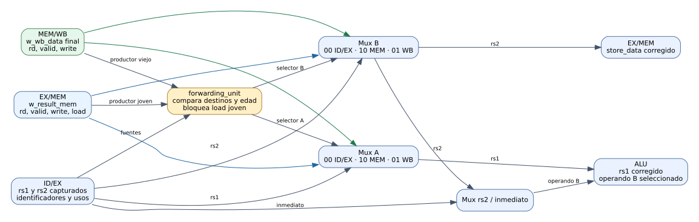
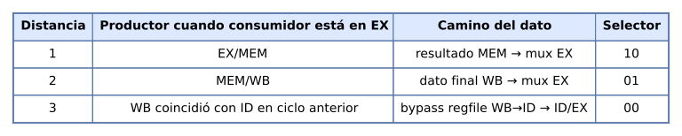

# 04 — Forwarding y riesgos RAW

Estado posterior: A-29 agregó HALT explícito a los programas y actualizó sus bancos. Los resultados de este informe conservan la evidencia histórica del milestone; el flujo vigente está en [07 — HALT y congelamiento](07_halt_y_congelamiento.md) y en el [README de programas](../../programs/README.md).

Este informe describe **A-M04, issues A-18 a A-20**. El CPU de cinco etapas ya captura operandos en ID/EX y escribe resultados en WB. El milestone añade una unidad combinacional que reconoce dependencias RAW y elige, para cada operando de EX, el resultado más reciente que ya está disponible. El [gate de validación](../validation/A-M04.md) conserva los comandos y resultados medidos.



[Ver diagrama ampliable](../diagramas/04_forwarding.svg) · [Fuente editable Graphviz](../diagramas/04_forwarding.dot)

## 1. Bloques y señales

`cpu.v` mantiene cuatro registros de pipeline. A-M04 agrega `u_forwarding: forwarding_unit` entre la salida de ID/EX, los productores EX/MEM y MEM/WB, y los operandos de `u_execute`. La unidad no almacena datos: compara los identificadores `rs1` y `rs2` de EX con `rd` de las dos etapas productoras y entrega dos selectores. Cada selector controla un mux de 32 bits.

```text
ID/EX ── rs1 capturado ──> mux A ──> rs1 corregido ──> ALU / base JALR
      └─ rs2 capturado ──> mux B ──> rs2 corregido ──> mux rs2/imm ──> ALU
                                                └─────> store_data de EX/MEM
EX/MEM ── resultado arquitectónico ──> mux A y mux B
MEM/WB ── resultado final de WB ──────> mux A y mux B
```

Las entradas de comparación son `w_valid_ex`, `w_uses_rs1_ex`, `w_uses_rs2_ex`, `w_rs1_ex`, `w_rs2_ex`, `w_valid_mem`, `w_reg_write_mem`, `w_mem_read_mem`, `w_rd_mem`, `w_valid_wb`, `w_reg_write_wb` y `w_rd_wb`. Los selectores `w_forward_a_ex` y `w_forward_b_ex` producen `w_rs1_fwd_ex` y `w_rs2_fwd_ex`. No se comparan valores de datos para decidir una dependencia: solo validez, permisos y números de registro.

`execute_stage` recibe los operandos corregidos. Para operaciones inmediatas selecciona `i_imm_ex` **después** del bypass de `rs2`, por lo que los bits de inmediato que coinciden con un número de registro no crean una dependencia ficticia. Para stores, `rs2` corregido se captura como `store_data` en EX/MEM. La base de JALR usa `rs1` corregido. Los operandos que alimentarán la comparación de branches están preparados, pero la decisión de salto y la redirección pertenecen a A-24/A-25.

## 2. Selección, edad y disponibilidad

| Selector | Origen de dato | Condición |
|---|---|---|
| `00` | ID/EX, lectura capturada del banco | Sin productor aplicable o productor joven load aún no disponible. |
| `10` | `w_result_mem` de EX/MEM | EX/MEM válido, escribe un `rd` no nulo igual a la fuente, y no es load. |
| `01` | `w_wb_data` de MEM/WB | WB válido y escritor coincidente, sin productor coincidente más joven. |
| `11` | Ninguno | No se genera. |

EX/MEM es la instrucción más joven. Si EX/MEM y MEM/WB escriben el mismo `rd`, gana EX/MEM, aunque la palabra antigua de WB también coincida. Una instrucción que escribe `x0`, una etapa inválida, un control `reg_write=0` y una fuente que la instrucción consumidora no usa quedan fuera de la selección.

Cuando EX/MEM contiene un load coincidente, su `w_result_mem` es la **dirección**, no el dato cargado. La unidad selecciona `00` y bloquea también el dato más viejo de MEM/WB para ese mismo destino. A-M05 deberá retener al consumidor e insertar una burbuja; este milestone no habilita la ejecución correcta de un load-use inmediato. Una carga que ya está en MEM/WB sí puede reenviar su dato mediante `w_wb_data`, el mismo mux que alimenta la escritura del regfile.

El `w_result_mem` de EX/MEM ya incluye los resultados especiales preparados en EX: LUI entrega su inmediato y JAL/JALR entregan PC+4. Por eso una instrucción dependiente recibe el enlace, no el destino del salto. El registro EX/MEM conserva la dirección de un acceso a memoria en el mismo campo; `i_mem_read_mem` impide interpretarla como dato de load.

Los selectores debug 3 y 4 siguen leyendo los operandos **capturados** en ID/EX. No muestran el bypass combinacional. Esto permite ver en una captura tanto el dato antiguo como, a través de las señales internas durante simulación, el dato que EX usa realmente. El layout público del dump no cambió.

## 3. Distancias RAW en el pipeline



[Ver diagrama ampliable](../diagramas/04_raw_timing.svg) · [Fuente editable Graphviz](../diagramas/04_raw_timing.dot)

La distancia cuenta posiciones de instrucciones en el programa, no ciclos de pausa. Para un productor `P` y consumidor `C`, sin stalls:

| Programa | Coincidencia temporal | Ruta correcta |
|---|---|---|
| `P; C` | P está en EX/MEM cuando C entra a EX. | `10`, resultado MEM. |
| `P; nop; C` | P está en MEM/WB cuando C entra a EX. | `01`, dato final WB. |
| `P; nop; nop; C` | P escribe en WB cuando C lee en ID. | Bypass WB→ID del regfile; C captura el dato y usa `00` en EX. |

La distancia 3 depende del bypass local del banco de registros implementado en A-07. No necesita crear una tercera entrada en los muxes de EX. El test observa los operandos capturados de ID/EX y exige selector `00`, de modo que un resultado final correcto por otra ruta no oculte un fallo de WB→ID.

## 4. Programa y oráculos de A-20

[`raw_distance.s`](../../programs/raw_distance.s) agrupa los escenarios con NOP de separación entre grupos. [`raw_distance.hex`](../../programs/raw_distance.hex) conserva 76 instrucciones y completa imem hasta 256 palabras con NOP; el HALT agregado por el ensamblador de B se retiró. El CPU todavía termina por avance acotado. El [README del programa](../../programs/README.md#programa-raw_distance-de-a-m04) documenta el comando de recodificación. Los resultados finales son constantes manuales dentro de `tb_raw.sv`, independientes del resultado observado en RTL.

| PC consumidor | Caso | Selectores A/B | Resultado esperado |
|---:|---|---|---:|
| 4 | distancia 1, `rs1` | 10 / 00 | x2=14 |
| 24 | distancia 1, `rs2` | 00 / 10 | x4=7 |
| 48 | distancia 2, `rs1` | 01 / 00 | x6=24 |
| 72 | distancia 2, `rs2` | 00 / 01 | x8=−9 (`fffffff7`) |
| 100 | distancia 3, `rs1` | 00 / 00 | x10=35, dato capturado=30 |
| 128 | distancia 3, `rs2` | 00 / 00 | x12=12, dato capturado=12 |
| 152 | dos fuentes de edades distintas | 01 / 10 | x15=10 |
| 176 | dos productores de x16 | 10 / 00 | x17=7, prevalece 3 sobre 1 |
| 196 | escritura previa a `x0` | 00 / 00 | x18=5, x0=0 |
| 224 | instrucción independiente | 00 / 00 | x23=4 |
| 248 | dos fuentes en orden inverso | 10 / 01 | x28=2 |
| 272 | dos productores de x29 para `rs2` | 00 / 10 | x30=8, prevalece 8 sobre 3 |

El test controla el PC de IF en cada uno de los 77 avances y el PC de EX una vez válida la etapa. También comprueba valid ID/EX/MEM/WB, ausencia de stores y HALT, las 32 palabras del banco de registros y las 256 palabras con su bit dirty de dmem. El marcador final es `x31=0x000005a5` en PC 288. El número de avances es exacto: una burbuja o stall adicional provoca fallo de PC o del límite temporal, aunque los registros terminen con valores correctos.

## 5. Verificación y límites

El test unitario de A-18 cubre 222 comprobaciones de coincidencia, prioridad, invalidación, `x0` y load joven. El arnés de A-19 cubre 109 comprobaciones de store inmediato, dos productores, inmediatos, enlaces JAL/JALR, load en WB y operandos de branch. `tb_raw` añade **1.293 comprobaciones** de distancias y estado final. La regresión disponible en la rama de A terminó con **18 testbenches y 265.851 comprobaciones**; la síntesis aislada del CPU pasó con **0 latches**. Los comandos exactos y warnings están en [A-20](../validation/A-20.md) y [A-M04](../validation/A-M04.md).

A-M04 valida el camino de datos RAW para operaciones aritméticas sin carga inmediata ni redirección. A-M05 agregará el interlock load-use, A-M06 evaluará y redirigirá branches y jumps, y A-M07 agregará HALT y congelamiento. La síntesis out-of-context demuestra elaboración y recursos locales; el timing de implementación y la aceptación en placa tienen sus propios milestones. No se modificó la interfaz pública del CPU ni se mezcló el worktree de B.
