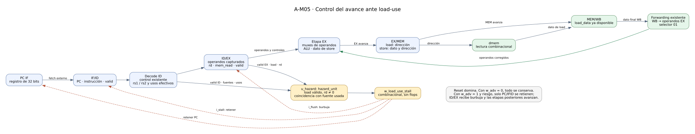
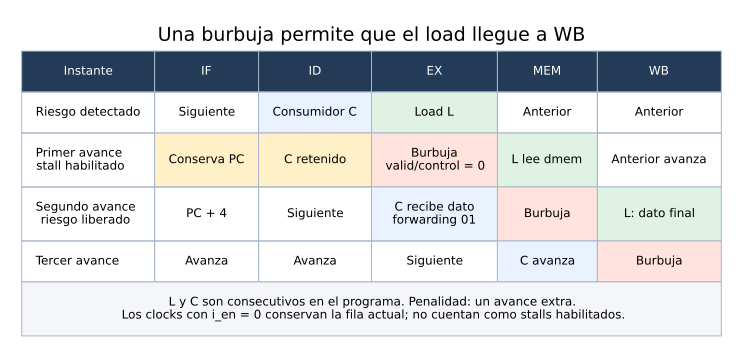

# 05 — Riesgos load-use, stall y burbuja

Este informe describe **A-M05, issues A-21 a A-23**. El milestone integra la detección de dependencias inmediatas de cargas y coordina el avance del pipeline para que el consumidor reciba el dato correcto. A-M04 ya había implementado forwarding; ahora una carga seguida por un consumidor real agrega exactamente una burbuja. El [gate A-M05](../validation/A-M05.md) conserva los resultados y el alcance del cierre.



[Abrir diagrama ampliable](../diagramas/05_load_use.svg) · [Fuente Graphviz](../diagramas/05_load_use.dot)

## 1. Por qué una carga necesita esperar

Para una operación aritmética, EX/MEM ya contiene el resultado que una instrucción joven puede necesitar en EX. Una carga tiene otra secuencia: EX calcula la **dirección**, MEM lee dmem y MEM/WB captura el **dato cargado**. Reenviar el resultado de EX/MEM de un load entregaría su dirección como operando.

Por ejemplo, `lw x1,0(x0); add x2,x1,x1` debe usar el contenido de memoria, no cero por ser esa su dirección. Si ambas instrucciones avanzaran sin pausa, ADD llegaría a EX mientras el load ocupa MEM. Bajo la organización acordada, la ruta utilizable para el dato de carga es MEM/WB→EX; por eso se retrasa un avance al consumidor.

La unidad de forwarding existente sigue dando prioridad al productor más joven. Si EX/MEM contiene un load coincidente, tampoco utiliza un valor más antiguo de WB para ese mismo destino. El interlock implementado en A-M05 impide que un consumidor válido necesite ejecutar con ese dato todavía indisponible.

## 2. Detección combinacional: A-21

`hazard_unit.v` tiene ocho puertos de entrada y una salida `o_stall`. El productor es la instrucción de EX y el consumidor es la de ID:

| Información | Señales del CPU | Función |
|---|---|---|
| Ocupación y tipo del productor | `w_valid_ex`, `w_mem_read_ex` | Solo una carga válida puede provocar load-use. |
| Destino del productor | `w_rd_ex[4:0]` | Se excluye x0. |
| Ocupación del consumidor | `w_valid_id` | Una burbuja no consume fuentes. |
| Fuentes del consumidor | `w_rs1_id`, `w_rs2_id` | Identificadores de cinco bits extraídos de la instrucción ID. |
| Consumo efectivo | `w_uses_rs1_id`, `w_uses_rs2_id` | Distingue un operando real de bits que pertenecen a un inmediato. |
| Resultado | `w_load_use_stall` | Condición combinacional de riesgo del ciclo actual. |

Primero se forma `w_load_pending` con valid EX, mem_read EX, rd distinto de cero y valid ID. Dos comparadores separados verifican coincidencia y consumo para rs1 y rs2. El `casez` de salida usa los patrones `11?` y `1?1`: con carga pendiente y al menos una coincidencia, stall vale uno; el valor por defecto es cero. No hay registros, reloj, reset ni historia de riesgos en esta unidad.

`uses_rs1/rs2` resulta esencial. En `addi x3,x0,1`, los bits `[24:20]` valen 1, pero pertenecen al inmediato. Un load previo a x1 no debe detener ese ADDI. En cambio, `sw x1,64(x0)` sí consume x1 como dato y debe esperar, aunque la base x0 sea independiente. R-ALU, stores y branches usan dos fuentes; I-ALU y loads usan solo rs1; JALR consume su base y LUI/JAL/HALT no consumen ninguna.

El test de A-21 recorrió las 1.048.576 combinaciones binarias de entrada y agregó 24 escenarios con el decoder real, para un total de 1.048.648 comprobaciones. Los detalles y las pruebas de sensibilidad están en [A-21](../validation/A-21.md).

## 3. Conexión al pipeline: A-22

`cpu.v` instancia `u_hazard`. `decode_stage.v` expone los identificadores y usos de ID mediante `o_rs1_id`, `o_rs2_id`, `o_uses_rs1_id` y `o_uses_rs2_id`. Son salidas combinacionales: se reutilizan `control`, la instrucción ID y su validez, sin agregar otro decoder ni almacenamiento. El consumo efectivo está habilitado por `i_valid_id && w_valid_instr_id`.

El riesgo no se añade a `w_adv`. Ese permiso común debe permitir que el load abandone EX y que las instrucciones anteriores completen sus efectos. Dentro de un avance habilitado se aplican controles distintos:

| Bloque | Sin riesgo | Con load-use |
|---|---|---|
| PC IF | PC+4. | Conserva el PC. |
| IF/ID | Captura la siguiente instrucción. | `i_stall=1`: conserva instrucción, PC y valid. |
| ID/EX | Captura el consumidor de ID. | `i_flush=1`: inserta burbuja. |
| EX/MEM | Captura la instrucción de EX. | Avanza igualmente: recibe el load. |
| MEM/WB | Captura resultado/dato de MEM. | Avanza igualmente. |
| Escrituras arquitectónicas | Según valid, control, avance y reset. | Las instrucciones anteriores pueden escribir; la burbuja no tiene efectos. |

Se conserva la política de A-12 para la burbuja: `valid`, controles y consumo quedan en cero; PC, datos e identificadores pueden retener la información anterior para depuración. Un PC retenido en EX no convierte la burbuja en una instrucción válida. Las palabras `info` y los valid permiten distinguir ambos estados.

No se agregan flops. El PC conserva su único proceso secuencial y los registros del pipeline mantienen un proceso por campo. El reset síncrono sigue teniendo prioridad sobre enable y controles locales.

## 4. Secuencia de una dependencia



[Abrir secuencia ampliable](../diagramas/05_load_use_timing.svg) · [Fuente Graphviz](../diagramas/05_load_use_timing.dot)

Cuando el load está en EX y el consumidor en ID, el primer avance conserva PC/IFID, inserta la burbuja y mueve el load a MEM. En el avance siguiente el load llega a WB y el consumidor entra a EX. En ese instante forwarding selecciona `01`, correspondiente a `w_wb_data`. La carga puede escribir el banco en el avance posterior; el bypass permite ejecutar al consumidor sin esperar a esa escritura.

La prueba inicial de A-22 almacena 9, ejecuta LW→ADD y obtiene x1=9, x2=18, x3=19 y memoria byte 4=19. Completa en 12 avances. Al sustituir ADD por una operación independiente necesita 11, sin stall. El test también verifica que un store y un WB anteriores pueden completar mientras se inserta la burbuja, y que no aparecen commits duplicados.

## 5. Pausa externa, stall local y reset

Un stall local retiene solo la parte joven del pipeline durante un avance. Con `i_en=0`, `w_adv` vale cero y se conserva todo el almacenamiento: PC, los cuatro registros, regfile y dmem/dirty. Un riesgo puede seguir visible combinacionalmente durante cientos de clocks pausados; esos clocks no representan burbujas adicionales.

A-22 compara snapshots completos durante pausas antes y después del stall, y prueba reset con enable cero mientras existe el riesgo. El reset limpia PC, valid, registros y dirty y permite volver a ejecutar el programa; imem sigue siendo externa y conserva su contenido. Las 8.381 comprobaciones y la traza detallada están en [A-22](../validation/A-22.md).

El debug público mantiene el mapa parcial previo: los valid están disponibles, pero los flags completos de stall/take/stop se completarán en A-30. El riesgo se observa directamente en `w_load_use_stall` dentro de las simulaciones de este milestone.

## 6. Regresión por consumidor: A-23

[`load_use.s`](../../programs/load_use.s) separa 13 grupos. Cada grupo escribe primero un centinela negativo distinto en x1, luego carga un dato y ejecuta inmediatamente el consumidor. Los cinco NOP restantes separan grupos. Así un dato capturado antiguo no coincide accidentalmente con el valor correcto del load. La preparación almacena 73 en dirección byte 0 y 96 en byte 4, con x9=21 para distinguir base, dato y otra fuente.

| Consumidor, PC byte | Camino verificado | Resultado / observación |
|---|---|---|
| ADD, 40 | Ambas fuentes desde WB. | 73+73=146; una burbuja. |
| SW, 72 | rs2 como dato desde WB. | Escribe 73 en dirección 64; una burbuja. |
| SW, 104 | rs1 como base desde WB. | Base 96, offset 4, dato 21: escribe en dirección 100. |
| ADDI, 136 | Inmediato aparenta rs2=x1. | x3=1, sin stall. |
| ADD, 168 | Fuentes independientes x9/x9. | x4=42, sin stall. |
| BEQ/BNE, 200/232/360/392 | rs1 o rs2 desde WB, comparación en arnés. | Igualdad y desigualdad, condiciones verdaderas y falsas. |
| ADD, 264 | Solo rs2 desde WB. | 21+73=94. |
| ADDI, 296 | Solo rs1 desde WB. | 73+2=75. |
| ADDI tras load a x0, 328 | Destino de carga descartado. | x0=0 y x7=0, sin stall. |
| SW, 424 | Base y dato desde WB. | Base 96, offset 8 y dato 96: escribe en dirección 104. |

En todos los casos dependientes, el test exige que el load esté en WB al entrar el consumidor a EX, que el selector de cada fuente dependiente sea `01` y que el dato capturado siga siendo el centinela anterior. Por ejemplo, el store de PC 72 conserva −2 en su rs2 capturado pero usa 73 para escribir; el store de PC 104 conserva −3 en rs1 pero usa 96 para calcular la dirección 100. El test comprueba tanto el operando como la escritura efectiva posterior.

Hay diez dependencias reales y tres controles sin riesgo. El programa completo termina por marcador tras **127 avances**, con **36 commits y cinco stores**. Las únicas palabras sucias finales son índices 0, 1, 16, 25 y 26, con datos 73, 96, 73, 21 y 96. Se comparan los 32 registros después de cada clock y las 256 palabras/dirty al finalizar.

La ejecución continua utiliza 128 clocks incluyendo reset. La pausada agrega tres clocks antes y uno después de cada stall: utiliza 168 clocks, conserva los mismos 127 avances y registra 30 clocks pausados con riesgo. Ambas terminan con el mismo estado y la misma secuencia de commits. El TB aporta 36.688 comprobaciones; el [README del programa](../../programs/README.md#programa-load_use-de-a-m05) contiene el mapa completo y la reproducción del hex.

## 7. Alcance de branches y entrega posterior

La etapa EX todavía no implementa la decisión ni redirección de branches. A-23 conecta un comparador del **testbench** a `w_rs1_fwd_ex` y `w_rs2_fwd_ex`, usa `funct3` para distinguir BEQ/BNE y contrasta las condiciones con constantes. Esto valida que la detección y el bypass entregan operandos correctos después de una burbuja, incluso para una dependencia exclusiva por rs2.

No demuestra cambios de PC ni descarte de instrucciones. A-24 implementará condición/destino en EX; A-25 conectará redirección y flush; A-26 cerrará los programas funcionales load→branch. HALT y congelamiento definitivo siguen en A-M07. El fin por marcador de los programas actuales se reemplazará al validar HALT en A-29.

## 8. Evidencia, archivos y reproducción

| Issue | Entrega | Evidencia |
|---|---|---|
| A-21 | `hazard_unit.v`, detección y barrido exhaustivo. | [A-21](../validation/A-21.md), `tb_hazard_unit`. |
| A-22 | Conexión en CPU/decode, hold y burbuja. | [A-22](../validation/A-22.md), `tb_load_use`. |
| A-23 | Programa, regresión por consumidor y cierre documental. | [A-23](../validation/A-23.md), `tb_load_use_consumers`. |

La regresión de cierre pasó **21 testbenches y 1.359.568 comprobaciones**, incluyendo RAW previo. La síntesis OOC del CPU pasó para Basys3 `xc7a35tcpg236-1` con 2.668 LUT totales (2.412 lógica y 256 memoria), 1.727 FF, cero latches y cero BRAM. Los warnings y límites de OOC están registrados en la evidencia; estos resultados no representan timing de implementación ni prueba física.

Los TB y programas se incorporaron al `.xpr` y al runner. Las dependencias de B permanecen en su worktree: no se copiaron ni fusionaron. Desde `Practico/TPs`:

```bash
python3 TP3_FINAL/tools/run.py tb tb_load_use_consumers --companion ../TPs-companion
python3 TP3_FINAL/tools/run.py test --companion ../TPs-companion
VIVADO=/tools/Xilinx/2025.1/Vivado/bin/vivado python3 TP3_FINAL/tools/run.py synth_ooc cpu --companion ../TPs-companion
```

El `test` disponible de A corre los TB registrados; no equivale al flujo futuro ISS/vectores/pytest de B. Las trazas `build/a22_trace.csv`, `build/a23_trace.csv` y sus VCD se regeneran al ejecutar los respectivos TB. Los diagramas SVG de este informe se generan desde sus fuentes `.dot` y se revisaron visualmente. A-M05 queda cerrado en simulación y síntesis local; A-24 es la siguiente issue habilitada.
