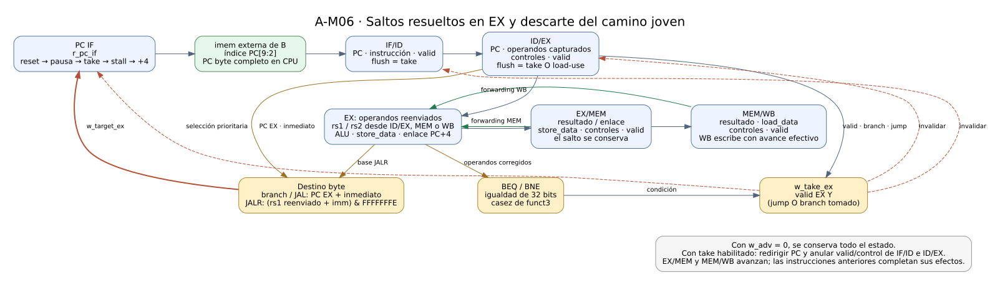
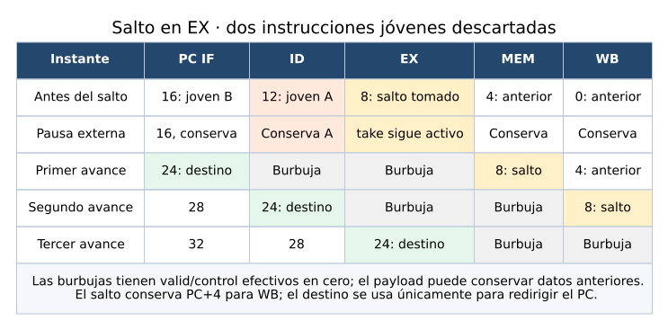

# 06 — Saltos, enlaces y flush

> Nota de reorganización: este documento conserva evidencia y comandos históricos. Los helpers `check_*` de A se retiraron y ya no se usa `--companion`; las rutas y comandos vigentes están en [organización del proyecto](organizacion.md).

Estado posterior: A-29 agregó HALT explícito a los programas y actualizó sus bancos. Los resultados de este informe conservan la evidencia histórica del milestone; el flujo vigente está en [07 — HALT y congelamiento](07_halt_y_congelamiento.md) y en el [README de programas](../../programs/cpu/README.md).

Este informe describe **A-M06, issues A-24, A-25 y A-26**. El CPU resuelve BEQ, BNE, JAL y JALR en EX, redirige el PC e invalida las dos instrucciones jóvenes cuando corresponde. La decisión usa los operandos corregidos por forwarding y conserva el enlace PC+4 para WB. Los programas de cierre prueban bucles, llamada/retorno y dependencias load→branch/JALR en ejecución continua y pausada. El [gate A-M06](../validation/A-M06.md) registra el cierre y sus límites.



[Abrir diagrama ampliable](../diagramas/06_control_flow.svg) · [Fuente Graphviz](../diagramas/06_control_flow.dot)

## 1. Qué se agregó en cada issue

| Issue | Entrega | Validación |
|---|---|---|
| A-24 | Igualdad BEQ/BNE, destino byte y `w_take_ex` en `cpu.v`. | [A-24](../validation/A-24.md), `tb_branch_execute`: cálculo aislado y llegada de operandos reales. |
| A-25 | Prioridad del PC y flush de IF/ID e ID/EX. | [A-25](../validation/A-25.md), `tb_flush`: camino descartado, enlace, pausa, reset y prioridades. |
| A-26 | Tres programas, tablas independientes, seguimiento del pipeline y contraste ISS. | [A-26](../validation/A-26.md), `tb_control_flow` y `check_control_programs.py`. |

A-26 no necesitó cambios de RTL: confirmó el circuito implementado en A-24/A-25. Los nuevos archivos de programas y TB están registrados en el runner y en `TP_FINAL.xpr`. Las dependencias de B siguen en su worktree, sin copia ni merge.

## 2. Evaluación en EX con operandos reenviados

La instrucción de EX conserva su PC, inmediato, funct3, valid y controles en ID/EX. Los datos capturados en ID/EX son `w_rs1_data_ex` y `w_rs2_data_ex`. Los muxes existentes producen `w_rs1_fwd_ex` y `w_rs2_fwd_ex`, que pueden provenir de EX/MEM o del resultado final de WB. Tanto la comparación de branch como la base de JALR usan estos últimos.

Por ejemplo, en el bucle `suma`, el ADDI de PC=16 incrementa x2 y el BNE de PC=20 lo compara inmediatamente con x3=11. El contador todavía no está almacenado en el banco cuando el branch ejecuta EX: se selecciona el productor de MEM. Comparar el dato capturado usaría el contador anterior y podría repetir una iteración de más.

| Instrucción | Condición | Destino | Resultado que puede escribir WB |
|---|---|---|---|
| BEQ | Igualdad de los 32 bits de rs1/rs2 reenviados. | PC de EX + inmediato B. | No escribe registro. |
| BNE | Desigualdad de esos 32 bits. | PC de EX + inmediato B. | No escribe registro. |
| JAL | Incondicional. | PC de EX + inmediato J. | PC de EX + 4, si rd≠0. |
| JALR | Incondicional. | (rs1 reenviado + inmediato I), con bit 0 en cero. | PC de EX + 4, si rd≠0. |

`w_operands_equal_ex` calcula la igualdad. Un `casez` de `w_funct3_ex` asigna `r_branch_taken_ex`: 000 selecciona igualdad, 001 selecciona desigualdad y el default es cero. Esa variable es combinacional, sin almacenamiento. El control existente valida los encodings soportados; no se agregaron BLT/BGE ni otras instrucciones.

`w_take_ex` requiere `w_valid_ex` y, además, un jump o un branch cuya condición se cumple. Una burbuja no puede provocar una redirección. El cálculo de condición se mantiene separado del avance secuencial; no se agregó una máquina de estados.

## 3. Destino byte y enlace son caminos diferentes

`w_target_ex` sirve para elegir el próximo PC. `w_result_ex` conserva el resultado arquitectónico destinado a EX/MEM y WB. En JAL/JALR este último es el enlace PC+4, calculado por `execute_stage`. Usar el destino como resultado de WB rompería el retorno de una función.

Las sumas son modulares de 32 bits. Branch/JAL usan **el PC de su propia instrucción en EX**, no el PC de IF que ya apunta a instrucciones posteriores. JALR usa `w_jalr_sum_ex` y borra exclusivamente el bit 0: una base 0x43 con inmediato cero produce 0x42, no 0x40.

El PC byte completo se conserva para fetch, debug y propagación por el pipeline. La memoria externa usa únicamente sus bits `[9:2]` para indexar las 256 palabras. Así PC=0x418 selecciona la palabra 6 sin perder el valor 0x418 en CPU; PC=26 selecciona esa misma palabra y conserva el bit 1. Las pruebas de A-25 verifican ambos comportamientos. La indexación de imem no redefine la operación de JALR ni introduce un trap.

## 4. Redirección, flush y prioridad

Al tomar un salto en EX hay dos instrucciones más jóvenes: una en ID y otra en IF. Ambas pertenecen al camino que se abandona. El siguiente avance carga `w_target_ex` en el PC, invalida IF/ID e inserta una burbuja en ID/EX.

| Prioridad | Acción |
|---|---|
| Reset síncrono | PC=0 y reset de los registros, aun con enable cero. |
| Sin `w_adv` | Se conserva todo el almacenamiento. Las condiciones combinacionales pueden seguir visibles. |
| `w_take_ex` dentro de un avance | Redirige PC y hace flush de IF/ID e ID/EX; gana al stall load-use. |
| Load-use sin salto | Retiene PC e IF/ID e inserta una burbuja en ID/EX. |
| Avance normal | PC+4 y captura de las siguientes instrucciones. |

Las conexiones concretas son `if_id.i_flush=w_take_ex` y `decode_stage.i_flush=w_take_ex || w_load_use_stall`. Este último control llega a ID/EX. Cada registro ya aplica reset, enable y prioridad de flush sobre stall; el CPU utiliza esa estructura sin duplicar almacenamiento.

EX/MEM recibe el salto válido y MEM/WB sigue avanzando. Una instrucción anterior puede escribir un registro o memoria en el mismo avance de la redirección. No se invalida todo el pipeline: hacerlo perdería enlaces y efectos anteriores legítimos. A-25 prueba un store anterior y un WB pendiente, junto con los dos efectos jóvenes que deben desaparecer.

La política de burbujas sigue A-12: `valid` y controles con efectos quedan en cero; PC, operandos y metadatos no normalizados pueden conservar datos anteriores para depuración. Un PC de salto retenido en una etapa inválida no representa otra ejecución del salto. El debug parcial debe leerse junto con valid/control.

## 5. Secuencia temporal y costo



[Abrir secuencia ampliable](../diagramas/06_flush_timing.svg) · [Fuente Graphviz](../diagramas/06_flush_timing.dot)

En el primer avance se descartan ID e IF y el destino queda disponible para fetch. En el segundo se captura la instrucción del destino en ID; en el tercero llega a EX. Cada salto tomado introduce **dos burbujas**. Un branch no tomado continúa secuencialmente y no provoca flush.

Un load seguido inmediatamente por branch o JALR agrega antes una burbuja load-use: se retienen PC/IFID, el load avanza y el consumidor entra a EX cuando el dato ya está en WB. Si ese consumidor toma un salto, entonces se aplican las dos burbujas de redirección. Son mecanismos distintos y se cuentan únicamente en avances habilitados.

La pausa externa conserva PC, registros del pipeline y estado arquitectónico. No convierte cada clock pausado en otra burbuja o en otra toma. A-25 inyecta además la coincidencia artificial take+stall para comprobar prioridad; en ejecución normal una instrucción EX no puede ser simultáneamente load y jump/branch.

## 6. Programa de suma y branch hacia atrás

[`suma.s`](../../programs/cpu/suma.s) conserva la lógica de la hoja de ruta: x1 inicia en cero, x2 en uno y x3 en once. Se suma el contador, se incrementa y se vuelve al cuerpo mientras sea distinto de once. Las diez iteraciones producen 1+…+10=55, es decir `0x37`. El store final deja ese valor en dirección byte cero.

La secuencia dinámica es `0,4,8`, seguida por diez repeticiones de `12,16,20`, y finalmente `24,28`. El BNE de PC=20 apunta a PC=12 con inmediato −8, toma nueve veces y no toma la última. Se comprueban los valores intermedios de cada acumulación y cada actualización del contador, no solo el resultado final. El marcador de PC=28 escribe x31=`0x5a5`.

Son 35 instrucciones retiradas, 24 escrituras de registro, un store, cero stalls y nueve redirecciones: **57 avances**. La ejecución continua usa 58 clocks incluyendo reset; la pausada usa 90 antes de las dos pausas finales de inspección. Ambas tienen los mismos efectos y avances.

## 7. Llamada, retorno y enlaces descartados

[`jump_link.s`](../../programs/cpu/jump_link.s) llama con JAL de PC=4 a una función en PC=80. JAL deja ra=8. La función cambia x10 de 3 a 7 y retorna mediante `jalr x0,ra,0`, sin modificar ra. La continuación copia ra en x11, verificando que el enlace se conservó.

La secuencia completa de PC es:

`0 → 4 → 80 → 84 → 8 → 12 → 16 → 28 → 40 → 44 → 64 → 68 → 72 → 96`.

BEQ de PC=12 no toma; el BNE inmediatamente posterior sí toma. En su destino hay otro JAL. Más adelante, ADDI produce la base impar 65 y el JALR siguiente usa forwarding de MEM para saltar a 64 y escribir enlace 48. La instrucción del destino calcula x8=49 y lo guarda en memoria[0]. Los JAL jóvenes descartados y los stores del camino incorrecto no pueden escribir registros ni ensuciar memoria.

Los registros finales significativos son ra=x11=8, x5=32, x6=65, x7=48, x8=49, x10=7 y el marcador. Son 14 instrucciones, nueve writes, un store, seis redirecciones y cero stalls: **30 avances**, con 31 clocks continuos o 51 pausados incluyendo reset y antes de la inspección final.

Los consumidores del enlace situados en el destino reciben el dato mediante WB→ID después de las burbujas del salto. Esto explica las expectativas actualizadas de `tb_forwarding_paths` en A-25: la toma del salto cambia la posición temporal del consumidor respecto del productor del enlace.

## 8. Load→branch y load→JALR

[`branch_load_use.s`](../../programs/cpu/branch_load_use.s) prepara memoria con 73 y 21. Antes de cada carga destinada a un branch escribe un centinela negativo en el registro consumidor. De esa forma, usar el dato capturado antiguo no puede pasar accidentalmente como el dato correcto.

| PC load → consumidor | Condición / destino | Camino del dato |
|---|---|---|
| 20 → 24 | BEQ 73=73, tomado a 36. | rs1 desde WB. |
| 40 → 44 | BNE 73≠21, tomado a 56. | rs2 desde WB. |
| 60 → 64 | BEQ 21=73, no tomado. | rs1 desde WB. |
| 76 → 80 | BNE 73≠73, no tomado. | rs2 desde WB. |
| 96 → 100 | JALR: (101+8)&FFFFFFFE=108; enlace 104. | Base rs1 desde WB. |

Cada pareja exige **una burbuja** y el selector WB correspondiente. El test compara los operandos corregidos, la condición, el destino y la secuencia efectiva posterior. Los branches no tomados ejecutan dos escrituras secuenciales legítimas; los tomados descartan stores y JAL jóvenes. Así se distinguen un flush correcto de uno que elimina instrucciones de más.

El estado final incluye x1=x4=x8=73, x2=x3=x9=21, x5=x6=101, x7=104, x10=1, x11=2, x12=3 y el marcador. Las únicas palabras dirty están en direcciones byte 0, 4, 12 y 16, con valores 73, 21, 101 y 3. Son 26 instrucciones, 17 writes, cuatro stores, cinco stalls y cuatro redirecciones: **43 avances**, con 44 clocks continuos o 74 pausados antes de la inspección final.

Esta prueba completa la aceptación funcional load→branch que A-23 solo había verificado por llegada de operandos y comparación en el arnés. La regresión conserva también los cuatro consumidores de branch del programa histórico `load_use.s`, adaptado a las redirecciones reales en A-25.

## 9. Cómo se construyó la evidencia

`tb_control_flow` usa tablas independientes de eventos, no un decoder que reproduzca el RTL. El JSON de cada programa contiene la secuencia dinámica esperada, los datos de cada commit/store, controles tomados/no tomados, operandos significativos, conteos y todo el estado final. Su representación `.expected.hex` permite cargar esas constantes en el simulador. El [README de programas](../../programs/cpu/README.md#programas-de-control-de-a-m06) documenta el formato.

Se comprueba la llegada de instrucciones en EX y MEM, y cada retiro de WB, incluyendo instrucciones sin escritura. El test valida todos los registros después de cada clock y recorre la memoria y dirty al terminar. Las pausas comparan snapshots de PC, 16 selectores del pipeline, 32 registros y 256 palabras/dirty. Antes de declarar éxito se exige el marcador, los conteos y el número exacto de avances. Un watchdog o un límite vencido es un fallo.

Las seis corridas aportan **71.326 comprobaciones**. Las dos pausas de inspección posteriores a cada marcador forman parte de las comparaciones, pero las cifras de clocks mostradas en las tablas anteriores se registran antes de esas pausas finales. `build/a26_trace.csv` y `build/a26_control_flow.vcd` permiten inspeccionar PC, valid, tomas, stalls y operandos.

`check_control_programs.py` verifica los hex contra el ensamblador de B, 13 codificaciones de control escritas como literales independientes y la equivalencia JSON/hex de las tablas. También compila y ejecuta las 96 pruebas del ISS de B, y luego contrasta sus tres estados arquitectónicos completos y cantidades de instrucciones con las tablas. No utiliza el ISS para demostrar ciclos, forwarding ni flush.

## 10. Cierre, reproducción y límites

La regresión de cierre pasó **24 testbenches y 1.451.285 comprobaciones**. XSim aprobó las 71.326 comprobaciones del nuevo test. Las seis variantes temporales incorrectas de cálculo, forwarding, flush, load-use, enlace y pausa fueron detectadas. La síntesis OOC del CPU pasó para Basys3 `xc7a35tcpg236-1`, con **2.773 LUT, 1.737 FF, cero latches y cero BRAM**. Los recursos coinciden con A-25 porque A-26 no cambia RTL.

Desde `Practico/TPs`:

```bash
python3 TP3_FINAL/tools/check_control_programs.py --companion ../TPs-companion
python3 TP3_FINAL/tools/run.py tb tb_control_flow --companion ../TPs-companion
python3 TP3_FINAL/tools/run.py test --companion ../TPs-companion
VIVADO=/tools/Xilinx/2025.1/Vivado/bin/vivado python3 TP3_FINAL/tools/run.py synth_ooc cpu --companion ../TPs-companion
```

El target `test` de A ejecuta los TB registrados; la comprobación de ensamblador/ISS es el primer comando, separado y explícito. El [gate](../validation/A-M06.md) y la [evidencia A-26](../validation/A-26.md) enlazan logs y reportes. Los SVG se generan desde fuentes DOT y se revisaron visualmente. No se modificaron los contratos públicos de B.

El RTL todavía no detiene la ejecución por HALT. El fin de estas pruebas es un marcador con avance acotado, seguido de pausa externa. Para el contraste del ISS se agrega HALT únicamente a una entrada temporal después del marcador; no se atribuye esa detención al CPU. La parada válida en WB, el vaciado y el freeze definitivo se implementarán y repetirán en A-M07.

El mapa debug público aún no incorpora los flags completos take/stall/stop; las pruebas observan esas señales internas. A-M08 completará la aceptación debug. La síntesis OOC no demuestra timing de implementación, bitstream ni placa; UART/host y las validaciones conjuntas posteriores mantienen su alcance separado. A-M06 queda cerrado en simulación y síntesis local y habilita A-27.
