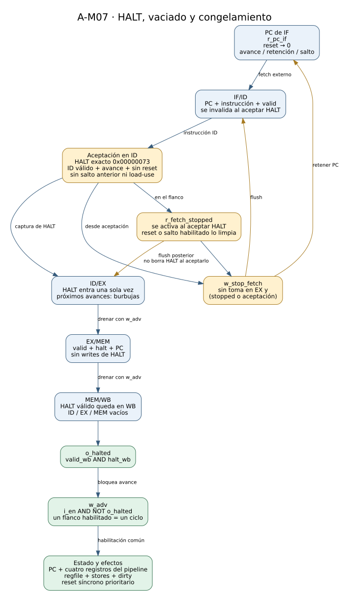
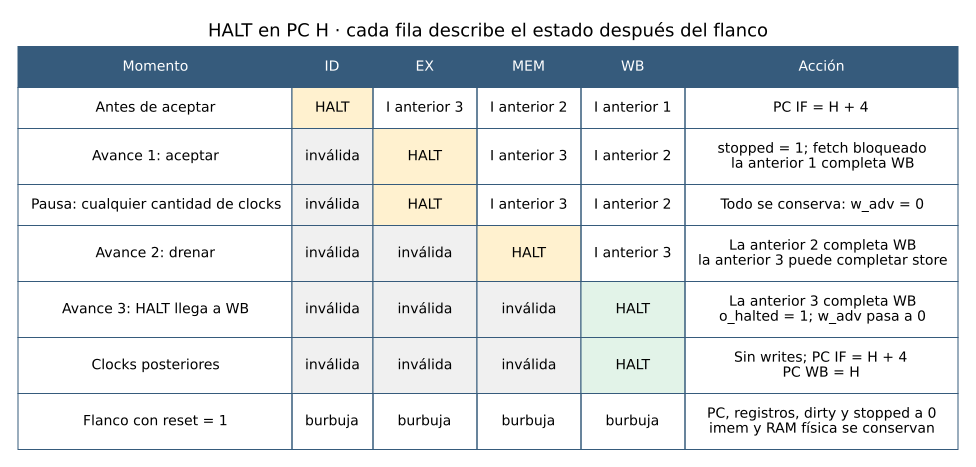

# 07 — HALT, vaciado del pipeline y ejecución controlada

> Nota de reorganización: este documento conserva evidencia y comandos históricos. Los helpers `check_*` de A se retiraron y ya no se usa `--companion`; las rutas y comandos vigentes están en [organización del proyecto](organizacion.md).

Este informe describe **A-M07, issues A-27, A-28 y A-29**. El CPU reconoce HALT exacto, deja de incorporar instrucciones nuevas, permite que terminen las anteriores y se congela cuando HALT llega válido a WB. Una pausa externa conserva el mismo estado; un STEP habilita un ciclo del pipeline. Reset domina esas dos condiciones y permite ejecutar otra vez el programa sin recargar imem.

El milestone está cerrado localmente en simulación. El [gate A-M07](../validation/A-M07.md) reúne la evidencia y distingue los resultados actuales de la síntesis OOC ya ejecutada en A-27. La integración con Debug Unit, los flags completos del dump y la aceptación conjunta mantienen el alcance de A-M08.

## 1. Entregas del milestone

| Issue | Trabajo realizado | Evidencia |
|---|---|---|
| A-27 | Aceptación de HALT en ID, registro de fetch detenido, vaciado y `o_halted` desde WB. | [A-27](../validation/A-27.md), `tb_halt_drain`. |
| A-28 | Auditoría de cada almacenamiento, enable global, freeze, STEP y reset prioritario. El RTL existente cumplió sin cambios. | [A-28](../validation/A-28.md), `tb_cpu_freeze`. |
| A-29 | HALT explícito en los seis programas históricos, RUN frente a STEP, caso descartado y caso sin HALT, actualización de scoreboards y cierre. No necesitó cambios de RTL. | [A-29](../validation/A-29.md), `tb_cpu_step_halt` y cuatro bancos adaptados. |

El RTL funcional agregado al milestone está en `cpu.v`: se reutilizan `control`, las cuatro etapas de almacenamiento, regfile y dmem. No se agregó una FSM ni un nuevo clock. El único almacenamiento de control nuevo es `r_fetch_stopped`, con un bloque secuencial independiente del PC. Los archivos de pruebas y programas están registrados en `TP_FINAL.xpr`; las fuentes de B siguen referenciadas desde su worktree, sin copia ni merge.

## 2. Bloques y señales



[Abrir el diagrama ampliable](../diagramas/07_halt_control.svg) · [Fuente Graphviz](../diagramas/07_halt_control.dot)

`w_halt_id` compara los 32 bits de `w_instr_id` con `RISCV_HALT_INSTR=0x00000073`. No se acepta cualquier instrucción SYSTEM. El `control` existente continúa generando los controles de HALT: la instrucción no escribe registro, no lee ni escribe memoria y no solicita branch/jump.

La aceptación `w_halt_accept_id` requiere, simultáneamente, ausencia de reset, `w_adv`, ID válido, encoding exacto, ausencia de `w_take_ex` y ausencia de `w_load_use_stall`. Separar la detección combinacional de la actualización permite observar una instrucción HALT pendiente durante una pausa sin aceptarla antes del flanco habilitado.

`r_fetch_stopped` recuerda la aceptación. Se activa en el flanco que captura HALT en ID/EX; reset lo limpia y una redirección habilitada anterior tiene prioridad. `w_stop_fetch` combina ese registro con la aceptación del ciclo, siempre condicionado a que no se esté tomando un salto en EX.

## 3. Por qué se detiene fetch y se sigue drenando

En el ciclo en que HALT está en ID todavía pueden existir instrucciones anteriores en EX, MEM y WB. Congelar todo en ese momento perdería sus resultados. Por ejemplo, un SW inmediatamente anterior debe completar su escritura y dirty antes de la parada, y un ADDI anterior debe llegar al banco de registros.

En el flanco de aceptación se realizan tres acciones coordinadas:

1. PC IF se conserva: no sigue incrementándose por el programa posterior.
2. IF/ID se invalida: la instrucción joven que estaba en IF no entra como válida.
3. HALT entra normalmente en ID/EX: no se aplica un flush que elimine su propia aceptación.

En los avances siguientes, `r_fetch_stopped` mantiene IF/ID inválido y fuerza burbujas en ID/EX. EX/MEM y MEM/WB siguen avanzando. Así HALT atraviesa el pipeline una sola vez y las instrucciones anteriores completan sus efectos.



[Abrir la secuencia ampliable](../diagramas/07_halt_timing.svg) · [Fuente Graphviz](../diagramas/07_halt_timing.dot)

Después del tercer avance mostrado, HALT está en WB y las etapas ID, EX y MEM están inválidas. Sus payloads pueden conservar valores anteriores según A-12; valid y controles determinan si representan una instrucción activa. Un PC retenido en una etapa inválida no significa que se esté ejecutando otra vez esa instrucción.

## 4. Parada en WB y habilitación común

`o_halted = w_valid_wb && w_halt_wb` es una salida combinacional, sin un registro extra que demore la señal. `w_adv = i_en && !o_halted` gobierna el avance del CPU. Cuando HALT llega a WB, `o_halted` sube después de ese mismo flanco y `w_adv` baja, reteniendo HALT allí en los clocks siguientes.

No existe realimentación combinacional circular: valid/halt de WB provienen de flip-flops. El cambio de `w_adv` modifica qué se capturará en el próximo flanco, no los valores ya almacenados en MEM/WB.

| Elemento | Condición de cambio normal |
|---|---|
| PC y `r_fetch_stopped` | Avance habilitado, con las prioridades locales. |
| IF/ID, ID/EX, EX/MEM y MEM/WB | Todos reciben `w_adv`; flush y stall actúan dentro de esa habilitación. |
| Escritura del banco | Avance, WB válido, reg_write, rd distinto de cero y ausencia de reset. |
| Store de dmem | Avance, MEM válido, mem_write, tamaño admitido y ausencia de reset. |
| Dirty | Solo cambia por store efectivo o reset. |
| Lecturas debug | Son combinacionales: pueden cambiar por selector, sin modificar almacenamiento. |

La auditoría de [A-28](../validation/A-28.md) enumera cada registro real y su guard, incluidas las señales que no aparecen en el dump. Los bloques de estado usan el mismo `posedge i_clock`; no se agregó división ni gating de clock. La síntesis OOC de A-27 registró cero latches inferidos: los módulos llamados registros o “latches del pipeline” están implementados con flip-flops por flanco.

## 5. Pausa y significado de STEP

Con `i_en=0`, `w_adv=0` y el almacenamiento del CPU se conserva. Esto incluye PC, todos los campos de los cuatro registros del pipeline, registros arquitectónicos, memoria física y dirty, además de fetch-stopped. Un stall o una toma combinacional pueden seguir visibles mientras el CPU está pausado, pero no producen una actualización sin avance.

STEP significa **un flanco habilitado del clock común**. Puede llenar una etapa, insertar una burbuja load-use, redirigir un salto o drenar HALT; no equivale a retirar una instrucción completa. La Debug Unit de B será quien produzca ese pulso desde el comando S; en este milestone el banco aplica directamente `i_en` al CPU.

`tb_cpu_step_halt` ejecuta cada programa continuamente y vuelve a ejecutarlo separando cada avance por dos clocks con enable cero. Compara 564 palabras de estado observable en el mismo número de avance: PC IF, stopped, halted, usos de operandos, 16 selectores, 32 registros y 256 pares dato/dirty. Esa comparación acredita equivalencia de RUN y STEP. Las expectativas arquitectónicas independientes y el ISS comprueban además que ambos recorridos sean correctos.

Los millones de comprobaciones de `tb_cpu_freeze` son comparaciones repetidas de almacenamiento durante miles de clocks. No representan millones de escenarios distintos. Su cobertura concreta incluye writes pendientes, load-use, salto tomado, HALT en distintas etapas y reset con enable cero o uno.

## 6. Reset mientras está pausado o halted

Reset es síncrono y prioritario. Antes del flanco no cambia el almacenamiento: si había HALT en WB, `o_halted` sigue alto aunque se active reset. En el flanco se limpian PC, todos los campos de los registros del pipeline, x1…x31, dirty y fetch-stopped. Al quedar WB inválido, `o_halted` baja.

La RAM física de dmem se conserva. Su lectura lógica queda en cero porque todos los dirty se limpian; un store parcial posterior mezcla sobre cero lógico. La imem es externa y tampoco se borra. Esto permite resetear y ejecutar otra vez el mismo programa, o cargar uno nuevo según el protocolo de B.

La prueba de reset de A-28 parte también de un ciclo con write de x4 en WB, store en MEM y branch tomado en EX. Reset debe cancelar esos efectos y restaurar el estado, aun cuando `i_en=0`. Sus pruebas comparan RAM física e imem, sin confundir reset lógico con borrado físico.

## 7. HALT en el camino equivocado

Si una instrucción anterior toma un salto en EX mientras HALT está en ID, la redirección gana. La condición `!w_take_ex` impide aceptar ese HALT y el flush de A-M06 descarta las dos instrucciones jóvenes. Tampoco se conserva un fetch-stopped espurio que impida ejecutar el destino.

El programa [`flush_halt.s`](../../programs/cpu/flush_halt.s) lo prueba de extremo a extremo. Un ADDI deja x1=1 y un BNE tomado de PC=4 salta a PC=16. HALT en PC=8 y el store de PC=12 se descartan. El destino escribe x2=9 y memoria byte 0=9; únicamente HALT en PC=24 detiene. El write de x10 y el store posteriores al HALT alcanzable tampoco se ejecutan.

## 8. Regresión con finalización real

Los seis `.s` históricos ahora incluyen HALT explícito; sus hex conservan las instrucciones anteriores y rellenan las posiciones restantes con HALT. Los marcadores x31 siguen verificándose, pero los bancos ya no se detienen por su commit. La [guía de programas](../../programs/cpu/README.md) describe formatos y resultados.

| Programa | PC HALT | Avances | Writes / stores | Stalls / tomas |
|---|---:|---:|---|---|
| Aritmética sin riesgos | 576 | 148 | 31 / 4 | 0 / 0 |
| Distancias RAW | 304 | 80 | 30 / 0 | 0 / 0 |
| Consumidores load-use | 452 | 131 | 36 / 5 | 10 / 2 |
| Suma de 1 a 10 | 32 | 57 | 24 / 1 | 0 / 9 |
| Llamada/retorno y JALR | 100 | 30 | 9 / 1 | 0 / 6 |
| Branch/load/JALR | 136 | 43 | 17 / 4 | 5 / 4 |
| HALT descartado | 24 | 10 | 2 / 1 | 0 / 1 |

Estos son ciclos de pipeline habilitados, no clocks físicos ni instrucciones del ISS. Por ejemplo, suma conserva x1=55 y memoria byte 0=55, con 35 instrucciones anteriores a HALT, nueve tomas y 57 avances. Su ejecución STEP usa 172 clocks incluyendo reset; RUN usa 58. En ambos casos se requieren los mismos 57 avances y termina el mismo estado.

En los programas de control y load-use, HALT se agregó inmediatamente después del marcador: llega a WB en el mismo flanco en que el marcador anterior escribe x31. Por eso sus conteos de fin no aumentan respecto del criterio anterior. Aritmética y RAW conservan tres NOP después del marcador y necesitan tres avances adicionales: 148 frente a 145 y 80 frente a 77.

## 9. Programa sin HALT y límites de responsabilidad

[`no_halt.s`](../../programs/cpu/no_halt.s) repite `jal x0,0`. El CPU sigue funcionando durante los 100 avances observados y nunca inventa `o_halted`. Una pausa externa lo conserva. El ISS independiente llega a su límite de 1000 instrucciones; no se comparan esos límites como si midieran lo mismo.

Si se ejecuta el banco con `+EXPECT_HALT_NO_HALT`, exigir HALT deliberadamente a ese programa produce `$fatal`, salida no nula y diagnóstico de PC/valid. Un timeout del banco significa que una expectativa no se cumplió; no puede imprimirse PASS ni presentarse como HALT. El timeout y abort del sistema serán decisiones de la Debug Unit de B, aceptadas durante la integración correspondiente.

## 10. Validación, reproducción y límites del cierre

La regresión de cierre pasó con **27 bancos y 10.462.527 comparaciones individuales**, sin FAIL ni warnings Icarus. El banco nuevo hizo 1.064.154 comprobaciones; XSim reprodujo ese resultado y los de los cuatro bancos históricos adaptados. El ISS de B confirmó los siete estados positivos y el límite del negativo. Sus 96 pruebas base y los 13 encodings literales de control también pasaron.

```bash
python3 TP3_FINAL/tools/check_halt_programs.py --companion ../TPs-companion
python3 TP3_FINAL/tools/check_control_programs.py --companion ../TPs-companion
python3 TP3_FINAL/tools/run.py tb tb_cpu_step_halt --companion ../TPs-companion
python3 TP3_FINAL/tools/run.py test --companion ../TPs-companion
```

Los comandos se ejecutan desde `Practico/TPs`. [A-29](../validation/A-29.md) registra versiones, logs, trazas, sensibilidad y el caso negativo. El nuevo banco también pasó desde un directorio con solo sus nueve hex de entrada, comprobando las rutas utilizadas por simulación en Vivado.

La síntesis OOC del RTL de este milestone se ejecutó en A-27: **2.867 LUT, 1.739 FF, cero latches y cero BRAM**, Basys3 `xc7a35tcpg236-1`. A-28 y A-29 no cambiaron el RTL; esos números son de aquella corrida y no una medición nueva. OOC no acredita timing implementado, bitstream ni placa.

El puerto `o_halted` ya funciona, pero el selector debug 15 todavía expone únicamente los cuatro valid. Con HALT en WB vale `0x00000008`; incorporar halted/stall/take/stop al mapa completo corresponde a **A-30**. El PC de parada es `w_pc_wb`, visible por selector 11, y no el PC IF que apunta después de HALT. A-M08 completará ese contrato y la integración con Debug Unit. No se atribuye una aprobación nueva al compañero ni se presenta simulación de CPU como validación física.
