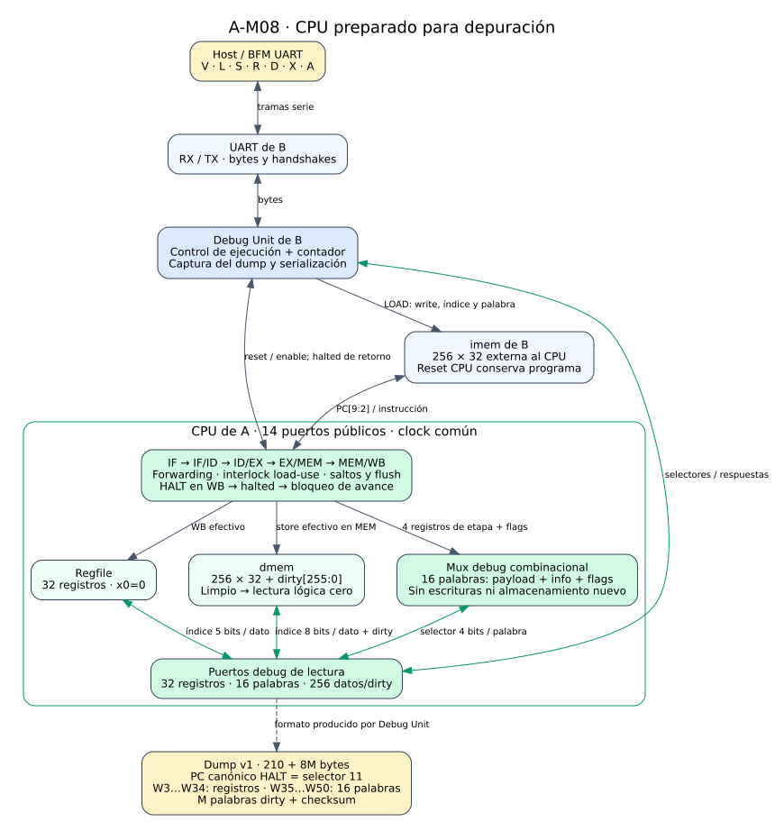
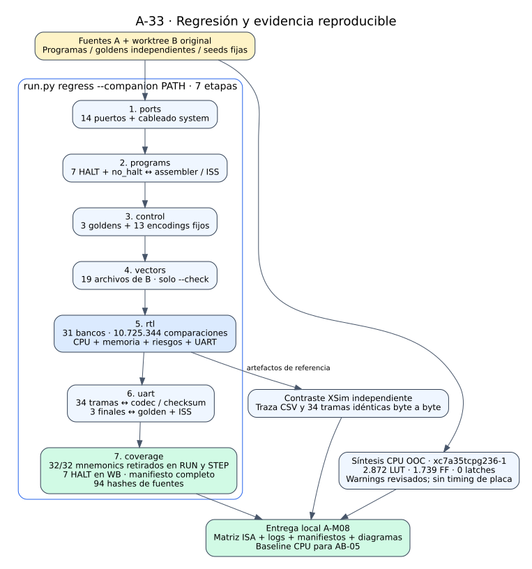

# 08 — CPU listo para debug y regresión final

> Nota de reorganización: este documento conserva evidencia y comandos históricos. Los helpers `check_*` de A se retiraron y ya no se usa `--companion`; las rutas y comandos vigentes están en [organización del proyecto](organizacion.md).

Este informe reúne **A-M08, issues A-30, A-31, A-32 y A-33**, y cierra localmente la parte de Persona A hasta el CPU preparado para depuración. El datapath expone sus registros y memoria, puede sustituir al stub con los mismos 14 puertos y ejecuta programas mediante la Debug Unit y la UART originales de B en simulación.

La regresión final pasó el 2026-11-09: **31 targets, 10.725.344 comparaciones, 32/32 instrucciones observadas en RUN y STEP, siete programas detenidos por HALT y un caso deliberado sin HALT**. Las comparaciones repetidas de snapshots explican gran parte del total; no equivalen a esa cantidad de escenarios distintos. El [gate A-M08](../validation/A-M08.md) y la [evidencia A-33](../validation/A-33.md) contienen comandos, seeds, logs y límites de aceptación.

## 1. Entregas del milestone

| Issue | Resultado implementado o verificado | Evidencia |
|---|---|---|
| A-30 | Mapa debug completo: 32 registros, 16 palabras de latch e info por etapa; flags de valid, halted, stall, take y stop_fetch. | [A-30](../validation/A-30.md), [mapa detallado](cpu_dump.md), `tb_cpu_debug`. |
| A-31 | Un mismo arnés usa CPU real o stub, con imem externa y barrido completo del estado público; auditoría de los 14 puertos y del cableado real de system. | [A-31](../validation/A-31.md), [interfaz](cpu_interfaz.md), `tb_cpu_contract` y variante stub. |
| A-32 | Integración de CPU real con system, Debug Unit, UART y BFM originales de B; 34 dumps y recuperación por reset/recarga. | [A-32](../validation/A-32.md), [integración](integracion_debug.md), `tb_system_cpu_smoke`. |
| A-33 | Runner de cierre por etapas, cobertura dinámica, manifiesto reproducible, contraste final con XSim, síntesis OOC actual y documentación del milestone. | [A-33](../validation/A-33.md), [matriz ISA](matriz_isa.md#cierre-final-a-33--cobertura-dinámica-del-cpu). |

El único ajuste funcional del CPU en M08 fue completar los flags de debug en A-30. A-31, A-32 y A-33 conservaron ese RTL y verificaron contratos, ejecución y evidencia. No se agregó un clock, una FSM ni almacenamiento al CPU. Se conservaron `casez`, las validaciones combinacionales separadas y los bloques secuenciales existentes con un registro por `always`; A-33 agrega herramientas y documentación, y corrige metadata del encabezado BFM en `.xpr`, sin modificar RTL ni TB.

## 2. Estructura integrada



[Abrir diagrama ampliable](../diagramas/08_cpu_debug.svg) · [Fuente Graphviz](../diagramas/08_cpu_debug.dot)

`system.v` de B conecta el CPU de A a una única imem externa y a la Debug Unit. Los tres bloques usan el mismo clock; la unidad de debug entrega reset y enable. STEP produce un único flanco habilitado y RUN habilita avances hasta HALT, abort o timeout. El CPU mantiene su protección interna `w_adv=i_en && !o_halted`: HALT válido en WB bloquea nuevos avances aunque llegue otro pulso externo de enable.

El PC del CPU tiene 32 bits y expresa bytes. Solamente el cableado hacia imem selecciona `[9:2]` para sus 256 palabras. Un PC alto, por ejemplo 1032, conserva su valor completo en debug aunque lea la palabra 2 de imem. La interfaz incluye clock/reset/enable, halted, dirección y dato de instrucciones, PC debug y tres pares de selección/respuesta para registros, latches y memoria.

El worktree de B se consultó en `f9dc09297f5bdcec6fb09048c003dbb6cd2188c0`, tras `pull --ff-only`, sin copiar sus carpetas ni incorporarlas a los cambios de A. `tbs.py` declara `CPU_FILES` de A y `SYSTEM_FILES` de B; el runner resuelve las rutas con `--companion`. El `.xpr` referencia las fuentes externas y sus includes para simulación.

## 3. Qué muestra el mapa debug

Las lecturas son combinacionales y no alteran el CPU. El selector de registros tiene cinco bits y recorre x0…x31; x0 siempre devuelve cero. Muestra el valor almacenado, sin sustituirlo por el bypass WB→ID usado por la ejecución.

| Selector de latch | Palabra de 32 bits |
|---|---|
| 0 / 1 | PC e instrucción capturados en IF/ID. |
| 2 / 3 / 4 / 5 / 6 | PC, rs1 capturado, rs2 capturado, inmediato e info de ID/EX. |
| 7 / 8 / 9 / 10 | PC, resultado, store_data e info de EX/MEM. |
| 11 / 12 / 13 / 14 | PC, resultado, load_data e info de MEM/WB. |
| 15 | Flags actuales del CPU. |

Los operandos de ID/EX son los capturados antes del forwarding de EX. En cambio, `store_data` de EX/MEM ya contiene el dato seleccionado para el store. Una etapa inválida puede conservar payload anterior; valid y controles determinan sus efectos. El mux no borra ese payload para ocultarlo al depurador.

Las palabras info conservan el layout común del [dump](cpu_dump.md#palabras-info). EX permite la máscara `FFFFFFFF`, MEM `8783801F` y WB `8600001F`: campos ausentes de una etapa salen cero. El selector 15 usa bits 0…3 para valid ID/EX/MEM/WB, bit 4 para halted, 5 para load-use, 6 para take y 7 para stop_fetch; bits 31:8 salen cero. Stall y take son condiciones combinacionales visibles incluso en pausa. Stop_fetch incluye la aceptación habilitada de HALT y el registro de fetch detenido; por eso su valor puede cambiar con enable antes de aceptar HALT, sin cambiar ningún flop.

En la parada real queda solo WB válido con HALT y los flags valen `00000098`. El PC canónico de HALT procede del selector 11; `o_dbg_pc` sigue mostrando el PC IF, que puede apuntar después de esa instrucción.

## 4. Memoria, dirty y reset

La dmem tiene 256 palabras de 32 bits. El selector debug de ocho bits es un **índice de palabra**; el CPU ejecuta loads/stores con direcciones byte. Una palabra limpia devuelve cero lógico aunque su array físico conserve datos de una corrida anterior. Cada store efectivo activa dirty, incluso si escribe cero. Debug solo lee.

El reset limpia registros, validez, control de fetch y dirty; domina enable=0 y halted. No borra físicamente el array de dmem ni resetea imem. Por eso SB/SH posteriores al reset deben mezclar contra cero lógico al escribir una palabra antes limpia. El arnés de A-31 verifica esa situación, el recorrido de los 256 dirty, direcciones límite, wraps y palabras escritas con cero. También comprueba que reset CPU conserva las 256 instrucciones cargadas.

## 5. De los puertos a las tramas UART

El arnés común de A-31 prueba sustitución y significado de los puertos. El smoke de A-32 añade los intercambios reales: V verifica versión; L carga y rellena imem con HALT bajo reset; S avanza un ciclo; R ejecuta; D obtiene estado sin avanzar; X resetea CPU conservando programa; A aborta una corrida activa.

La Debug Unit serializa W3…W34 como los 32 registros y W35…W50 como las 16 palabras de latch. W51 indica M palabras dirty; cada entrada posterior lleva dirección byte y valor. El dump ocupa `210+8M` bytes, usa little-endian y termina con checksum. Las 34 tramas del banco se comparan con el estado público pausado, luego se decodifican y recodifican usando el host original de B.

`branch_load_use` termina en 43 avances acumulados, PC HALT 136 y cuatro palabras dirty; `suma` en 57, PC 32 y mem[0]=55; `flush_halt` en 10, PC 24 y mem[0]=9. Esos tres resultados se comparan con el ISS y con goldens independientes. Los pasos y los D repetidos conservan igualdad byte a byte; se verifican el stall del paso 7 y la toma del paso 9.

`no_halt` usa JAL a sí mismo. El abort se observa a los 338 avances; tras reset, dos RUN consumen presupuestos de 1000 ciclos cada uno y dejan el contador acumulado en 1000 y 2000. Un STEP posterior limpia las causas previas y deja 2001. Para este programa se exigen registros cero, ausencia de stores y halted=0: que el ISS indique `limit` no demuestra por sí solo igualdad del estado parcial. La recarga de `flush_halt` acredita recuperación posterior.

## 6. Regresión final y cobertura



[Abrir diagrama ampliable](../diagramas/08_regresion.svg) · [Fuente Graphviz](../diagramas/08_regresion.dot)

El nuevo `run.py regress` ejecuta siete etapas con logs separados: puertos; assembler/goldens/ISS para ocho programas; control con tres goldens y trece encodings fijos; 19 vectores de B mediante `--check`; los 31 targets RTL; análisis de las 34 tramas UART; y auditoría final de cobertura. Un fallo conserva salida no nula y diagnóstico. UART depende de RTL correcto y cobertura depende de las seis etapas previas, para evitar aceptar artefactos anteriores después de un error.

La auditoría compara el inventario requerido con el registrado y el realmente ejecutado. Exige PASS con contador en cada target, cierre del runner y ausencia de FAIL o warnings Icarus sin clasificar. Comprueba las rutas del `.xpr` y que ningún TB local quede fuera del registro. Emite `a33_coverage.json`, `a33_retirement.csv` y `a33_coverage.md` en build.

La cobertura ISA deriva de `a29_step_trace.csv`, generado de nuevo por el banco común. Como las filas se muestrean después del flanco, el retiro corresponde al PC/valid de WB de la fila anterior cuando el flanco actual está habilitado y el CPU aún no estaba halted. Se decodifica la palabra del programa en ese PC, se exige el total independiente de instret y se comprueban las 32 instrucciones **en cada modo**, además de siete HALT observados en WB. NOP cuenta como ADDI por su encoding. HALT se verifica por separado y no se suma al instret del ISS.

| Programa | PC HALT byte | Avances | Retiradas sin HALT | Writes / stores | Stalls / tomas |
|---|---:|---:|---:|---|---|
| `arith_no_hazard` | 576 | 148 | 144 | 31 / 4 | 0 / 0 |
| `raw_distance` | 304 | 80 | 76 | 30 / 0 | 0 / 0 |
| `load_use` | 452 | 131 | 113 | 36 / 5 | 10 / 2 |
| `suma` | 32 | 57 | 35 | 24 / 1 | 0 / 9 |
| `jump_link` | 100 | 30 | 14 | 9 / 1 | 0 / 6 |
| `branch_load_use` | 136 | 43 | 26 | 17 / 4 | 5 / 4 |
| `flush_halt` | 24 | 10 | 4 | 2 / 1 | 0 / 1 |
| `no_halt` | Sin HALT | 100 | 32 | 0 / 0 | 0 / 33 |

Los conteos coinciden en RUN y STEP. En `no_halt`, 100 avances es el intervalo acotado del banco, con 32 retiros y 33 tomas; el ISS usa un límite de 1000 instrucciones. No se equiparan ciclos con instrucciones. La [matriz ISA](matriz_isa.md#cierre-final-a-33--cobertura-dinámica-del-cpu) relaciona las 33 filas con programas, PC y TB, y añade los criterios microarquitectónicos.

| Banco | Seed hexadecimal |
|---|---|
| `tb_mem_wb` | `16abcdef` |
| `tb_execute_stage` | `15e05eed` |
| `tb_decode_stage` | `14dec0de` |
| `tb_alu` | `5eed1234` |
| `tb_pipeline_regs` | `12ab5eed` |
| `tb_fetch` | `13fe7c01` |

Los demás bancos son dirigidos y no usan seed aleatoria. El manifiesto guarda rama, commit, estado del árbol A/B y SHA-256 de 94 entradas: fuentes RTL/TB, encabezados, programas, herramientas y `.xpr`. XSim 2025.1 repitió el banco común y el smoke; su CSV completo RUN/STEP y las 34 tramas coinciden byte a byte con Icarus. Los dumps de XSim pasan también por el codec y el ISS.

## 7. Comandos de reproducción

Desde `Practico/TPs`, con el worktree de B disponible:

```bash
git -C ../TPs-companion pull --ff-only
python3 TP3_FINAL/tools/run.py regress --companion ../TPs-companion
python3 TP3_FINAL/tools/check_final_xsim.py --companion ../TPs-companion --vivado-bin /tools/Xilinx/2025.1/Vivado/bin
python3 TP3_FINAL/tools/check_system_dumps.py --companion ../TPs-companion --frames TP3_FINAL/build/a33_xsim_frames
VIVADO=/tools/Xilinx/2025.1/Vivado/bin/vivado python3 TP3_FINAL/tools/run.py synth_ooc cpu --companion ../TPs-companion
```

`regress` guarda `a33_regress.json` y `a33_<etapa>.log`. XSim es un contraste opcional separado porque necesita la instalación de Vivado; utiliza directorios de build independientes y los hex originales mediante enlaces locales. Sus comandos concretos de compilación/elaboración/simulación quedan en `a33_xsim_<top>.log`. La síntesis se ejecuta por separado y conserva `build/synth_ooc/cpu/vivado.log`, `util.rpt` y `methodology.rpt`. Build está ignorado por Git; los resultados observados se transcriben en la evidencia versionada y se regeneran con esos comandos.

## 8. Síntesis y entrega a B

La síntesis OOC final del CPU usa **xc7a35tcpg236-1** y produjo 2.872 LUT totales: 2.616 de lógica y 256 de RAM distribuida; 1.739 flip-flops; cero latches, BRAM y DSP. No aparecieron múltiples drivers, redes implícitas ni latches inferidos. Los warnings revisados corresponden a bits altos de dirección dmem sin uso, criterio de paralelización de síntesis, clock OOC sin HD.CLK_SRC y DRC limitado por OOC. Methodology informa 64 avisos SYNTH-5 de RAM distribuida y 196 TIMING-18 de delays de entrada/salida ausentes, esperables en este ensayo aislado.

El `.xpr` preexistente todavía declara `xc7a35ticpg236-1L`; la corrida OOC crea un proyecto en memoria con la parte correcta. Esta diferencia queda explícita para la preparación de placa compartida. El proyecto es de Vivado 2025.2; la instalación disponible es 2025.1. Se corrigió una declaración XML inválida del header UART y se verificaron los diez archivos nuevos sobre una copia read-only compatible con 2025.1. La [evidencia A-33](../validation/A-33.md#registro-del-proyecto-y-versiones-de-vivado) detalla la adaptación temporal y sus límites. El reporte OOC no certifica frecuencia, timing implementado, recursos del sistema completo ni funcionamiento físico.

La entrega permite que B use el CPU real desde su `system.v`, con las mismas conexiones y sin `CPU_STUB`. Los programas, goldens, fuentes de simulación y documentos están registrados o referenciados en Vivado; no hay merge ni copia de carpetas de B. La aceptación conjunta de interfaz, AB-05 y la validación de FPGA continúan siendo trabajo compartido. El cierre local de A-M08 no adjudica aprobación A+B ni marca completadas esas etapas.
