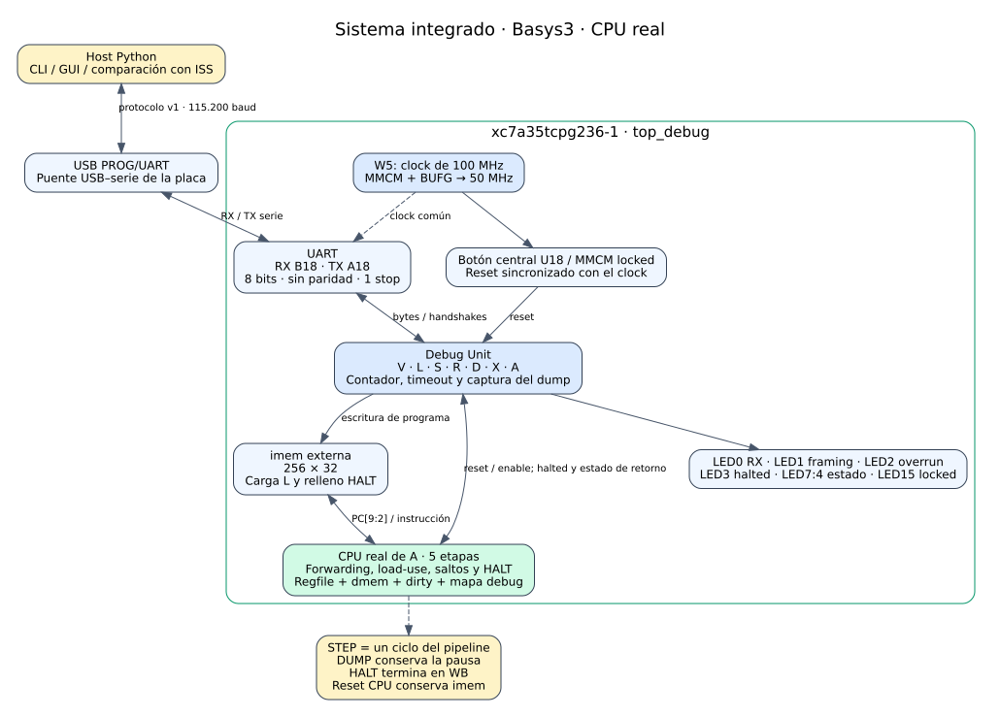

# 09 — Integración CPU, Debug Unit y preparación de Basys3

Estado al **2026-11-09**: sistema completo validado en simulación, implementado para **xc7a35tcpg236-1**, con bitstream generado y proyecto Vivado listo. La programación y comprobación física quedan para el usuario, tal como se acordó en esta sesión. No se presenta la simulación como una prueba de placa.

La parte fue confirmada por el usuario como Basys3. El nombre inicialmente indicado, `xc7a35tcpg236-1L`, no existe en el catálogo de Vivado instalado; `xc7a35ticpg236-1L` es otra variante. Se usa `xc7a35tcpg236-1`, coherente con la [referencia oficial de la Basys3](https://www.amd.com/en/corporate/university-program/aup-boards/digilent-basys3.html). Pines y clock de entrada se cotejaron con el [Master XDC de Digilent](https://github.com/Digilent/digilent-xdc/blob/master/Basys-3-Master.xdc).

## Estructura y cambios



[SVG ampliable](../diagramas/09_basys3_system.svg) · [Fuente Graphviz](../diagramas/09_basys3_system.dot)

`CPU_FILES = DATAPATH_FILES` habilita el CPU real en el runner de B. `tb_system_prog` usa UART, Debug Unit, imem y CPU del árbol local; la regresión compara sus dumps con el ISS y los goldens de los nueve programas. Se conservan los bancos con stub para comprobar sus contratos originales. No se agregó un adaptador entre CPU y Debug Unit ni se modificaron sus puertos, protocolo o RTL.

El top de placa es `top_debug`. `clk_gen.v` proporciona un MMCM y BUFG con salida de 50 MHz a partir del clock de 100 MHz de W5. Es el mismo clock para UART, Debug Unit y CPU: STEP entrega enable, no un clock distinto. El reset del botón central o de MMCM sin locked se sincroniza en el top. `basys3_debug.xdc` incluye ahora el clock primario; esto permite usar el mismo constraint desde el proyecto y desde el build por Tcl.

La UART física usa **115.200 baud, 8N1**, sin control de flujo. Los valores acelerados de los TB no alteran la velocidad de placa. El timeout de RUN es 150.000.000 ciclos: aproximadamente tres segundos con el clock de sistema de 50 MHz.

El proyecto se regeneró nativamente con **Vivado 2025.1**, corrigiendo la parte y el top de síntesis. Incluye todas las fuentes y bancos locales, programas, documentos e include paths. El top de simulación por defecto es `tb_system_cpu_smoke`, con `run all` y ROOT configurado para localizar los archivos. Se comprobó la apertura y ejecución desde el `.xpr`. Los archivos de caché/estado de Vivado que estaban versionados dejaron de seguirse en Git; se regeneran localmente.

`run.py project` y `tools/create_project.tcl` permiten regenerar el proyecto cuando cambia de máquina o ruta, incluido ROOT de simulación. Los procesos Vivado guardan temporales en sus directorios de build para evitar colisiones. `build_bit.tcl` comprueba setup, hold y errores DRC antes de producir el bitstream; guarda checkpoint enrutado, timing, utilización y methodology. `program.tcl` comprueba el archivo y exige un único dispositivo XC7A35T antes de programar. Su ejecución física no se realizó aquí.

## Artefacto listo para programar

- Bitstream: [`build/bit/top_debug_50mhz_mmcm/top_debug.bit`](../../build/bit/top_debug_50mhz_mmcm/top_debug.bit).
- Proyecto: [`VIVADO/TP_FINAL/TP_FINAL.xpr`](../../VIVADO/TP_FINAL/TP_FINAL.xpr).
- [Manifiesto, hashes y recursos](../../build/integration/release_manifest.json).
- Tamaño: **2.192.133 bytes**.
- SHA-256: `07da69305434f587422f74998a4db8967fc7354a11530bb609ee7488beadb52a`.

El bitstream configura la SRAM del FPGA mediante JTAG y debe volver a cargarse tras apagar la placa. La programación persistente de la memoria de configuración no forma parte de esta entrega. Build está ignorado por Git: el bitstream existe en esta máquina y se regenera con los comandos siguientes si se vuelve a clonar el proyecto.

## Reproducir las comprobaciones y el bitstream

Desde `Practico/TPs`, en Linux:

```bash
uv venv --python /usr/bin/python3 TP3_FINAL/build/venv
uv pip install --python TP3_FINAL/build/venv/bin/python -r TP3_FINAL/sw/requirements.txt
TP3_FINAL/build/venv/bin/python TP3_FINAL/tools/run.py test
TP3_FINAL/build/venv/bin/python TP3_FINAL/tools/run.py regress --levels iss,fake,rtl
VIVADO=/tools/Xilinx/2025.1/Vivado/bin/vivado TP3_FINAL/build/venv/bin/python TP3_FINAL/tools/run.py project
VIVADO=/tools/Xilinx/2025.1/Vivado/bin/vivado TP3_FINAL/build/venv/bin/python TP3_FINAL/tools/run.py bit top_debug --mhz 50 --clk mmcm
```

En Windows, usar `py -m venv TP3_FINAL/build/venv`, `TP3_FINAL/build/venv/Scripts/python.exe -m pip install -r TP3_FINAL/sw/requirements.txt` y ese ejecutable para los comandos del runner. Establecer `VIVADO` a la ruta real de `vivado.bat`. No habilitar `CPU_STUB` al generar el diseño integrado. La ruta MMCM es la implementada y verificada en esta entrega; no necesita generar un IP Clock Wizard.

El proyecto entregado puede abrirse directamente en Vivado 2025.1. Si se mueve de ruta o se abre con otra instalación, regenerarlo con `run.py project` usando esa instalación. Al volver a generar el bitstream desde la GUI, seleccionar `top_debug` y `xc7a35tcpg236-1`; la salida de esa corrida estará en `TP_FINAL.runs/impl_1/`. El archivo ya generado por el runner está en build, en la ruta indicada arriba.

## Validación realizada

| Comprobación | Resultado | Evidencia |
|---|---|---|
| Regresión común con RARS | ISS: 96 checks; 19 vectores; 44/44 targets RTL; tests Python; ambas mutaciones UART detectadas. | [full_test.log](../../build/rars_install/full_test.log) |
| Suite Python final | **338 passed, 14 skipped**, incluyendo 49 tests sobre capturas UART simuladas del RTL y diez comparaciones con RARS. | [full_test.log](../../build/rars_install/full_test.log) |
| RARS dirigido | Diez pruebas aprobadas: ocho programas comparados por registros y dos pruebas de codificación del ensamblador. `no_halt` conserva su exclusión explícita. | [rars_tests.log](../../build/rars_install/rars_tests.log) |
| Nueve programas de B | ISS, FakeBoard y CPU real por UART simulada coinciden con sus expectativas. | [program_regression.log](../../build/integration/program_regression.log) |
| Host sobre UART real | 34 tramas: decode/encode exacto, checksum corrupto rechazado, STEP/D estables, reset/recarga y tres finales contra golden independiente e ISS. | [recordings.log](../../build/integration/recordings.log), `sw/tests/test_system_recordings.py` |
| Proyecto Vivado y XSim | Apertura nativa y smoke por defecto: 28.435 checks; 34 tramas idénticas byte a byte con Icarus. | [project_sim.log](../../build/integration/project_sim.log), [xsim_simulate.log](../../build/integration/xsim_simulate.log), [contraste](../../build/integration/xsim_comparison.log) |
| Implementación completa | Place/route, bitstream y timing correctos; DRC: cero infracciones. | [bitstream.log](../../build/integration/bitstream.log), [timing](../../build/bit/top_debug_50mhz_mmcm/timing.rpt), [DRC](../../build/bit/top_debug_50mhz_mmcm/drc.rpt) |

La primera corrida común terminó con los 279 tests Python anteriores; tras agregar la comprobación del host sobre capturas UART se repitió toda la suite Python y quedó en 328 aprobados y 24 omitidos ([evidencia anterior](../../build/integration/pytest_final.log)). Después se instaló el JAR oficial de RARS 1.6 en `tools/rars1_6.jar`, con OpenJDK 21.0.12.1 ya disponible, y se repitió la regresión completa: las diez pruebas pendientes por RARS aprobaron, sin modificar código ni expectativas. El resultado actual es **338 aprobados y 14 omitidos**: 13 pruebas de GUI sin pantalla y un `no_halt` excluido deliberadamente de RARS. No se declara comprobada la ventana gráfica en este entorno.

El JAR permanece ignorado por Git. Su origen y SHA-256 están en el [README](../../README.md) y en el [registro de instalación](../../build/rars_install/installation.json). Esta instalación y nueva regresión no modifican el RTL ni el bitstream preparado. Las pruebas físicas siguen pendientes de realizar con la placa del compañero.

Los nuevos tests reutilizan capturas únicamente si sus archivos y el log PASS son posteriores a sus dependencias; si faltan o quedaron antiguos, ejecutan el smoke mediante el runner común. No agregan otro runner ni otro protocolo. El fallo esperado de cada mutante UART en el log común es una detección exitosa, no un fallo del diseño original.

| Programa de B | Causa | PC HALT byte | Ciclos CPU en el TB | Palabras dirty |
|---|---|---|---:|---:|
| `alu_nodep` | HALT | 96 | 28 | 0 |
| `branches` | HALT | 68 | 26 | 0 |
| `call_ret` | HALT | 24 | 103 | 11 |
| `const32` | HALT | 52 | 17 | 0 |
| `load_use` | HALT | 60 | 25 | 3 |
| `mem_bytes` | HALT | 96 | 28 | 6 |
| `no_halt` | timeout | No aplica | 20000 | 0 |
| `raw_hazards` | HALT | 72 | 22 | 2 |
| `suma` | HALT | 28 | 56 | 1 |

El ISS cuenta instrucciones y el CPU cuenta ciclos de avance; no se exige igualdad entre ambas cantidades. En `no_halt`, la comparación canónica solo comprueba la causa límite. Además, las capturas del bucle sin HALT de A comprueban estado parcial explícito: registros cero, memoria sin stores, aborted/timeout correctos, dos presupuestos de 1000 ciclos, contador acumulado 2000 y STEP posterior 2001. La recuperación carga `flush_halt` y vuelve a obtener HALT con su resultado independiente.

Las suites de A (`programs/cpu/`) y de B (`programs/`) conservan sus programas y goldens separados. Se probaron ambas mediante sus bancos y herramientas correspondientes; no se cambiaron expectativas para conseguir coincidencia.

## Timing y recursos del sistema completo

| Recurso / criterio | Resultado enrutado |
|---|---:|
| Clock de sistema | 50 MHz |
| WNS / TNS de setup | +6,798 ns / 0 ns |
| WHS / THS de hold | +0,067 ns / 0 ns |
| Endpoints con fallo setup / hold | 0 / 0 |
| LUT totales / lógica / RAM | 3.472 / 3.040 / 432 |
| Flip-flops | 2.108 |
| Latches / BRAM / DSP | 0 / 0 / 0 |
| MMCM / BUFG | 1 / 1 |
| Infracciones DRC | 0 |

La [utilización por jerarquía](../../build/bit/top_debug_50mhz_mmcm/util_hier.rpt) identifica `u_system/u_cpu` como módulo `cpu`, con sus etapas reales; no es una implementación del stub. El [check_timing](../../build/bit/top_debug_50mhz_mmcm/check_timing.rpt) informa cero registros sin clock, cero endpoints internos sin restricciones y cero loops. Las entradas asíncronas del botón/UART y las salidas serie/LED mantienen las excepciones intencionales del constraint de B; no son una interfaz síncrona externa con delays inventados.

Se revisaron los avisos: 44 Synth 8-7129 por bits altos de dirección dmem sin uso, 14 Synth 8-3917 por LED14:8 constantes, un Synth 8-7080 por criterio de paralelización y 64 SYNTH-5 de methodology por RAM distribuida. Dos **Common 17-570** son critical warnings por no poder escribir preferencias de WebTalk en el entorno restringido; no son fallos de DRC o timing del circuito. La implementación completó y el bitstream se escribió. La corrida inicial interrumpida por colisión de temporales Vivado se repitió con cada proceso aislado en build; los números anteriores corresponden a la corrida final correcta.

## Programar y probar después en la placa

1. Conectar la Basys3 por USB PROG/UART y encenderla. Abrir Hardware Manager, conectar el target y seleccionar el dispositivo XC7A35T.
2. Elegir **Program Device** y seleccionar `build/bit/top_debug_50mhz_mmcm/top_debug.bit`. Tras programar, LED15 indica locked y el botón central resetea el sistema. LED3 indica halted; LED1 y LED2 señalan errores de framing y overrun.
3. Identificar el puerto serie: `TP3_FINAL/build/venv/bin/python -m serial.tools.list_ports` en Linux, o el ejecutable equivalente del venv en Windows. Usar ese puerto en los comandos siguientes y cerrar cualquier otra aplicación que lo tenga abierto.
4. Desde `TP3_FINAL/sw`, abrir `../build/venv/bin/python -m host.gui --port /dev/ttyUSB1` o `../build/venv/bin/python -m host.cli --port /dev/ttyUSB1`. En Windows usar `../build/venv/Scripts/python.exe` y el COM correspondiente. El nombre mostrado es un ejemplo, no un puerto detectado en esta sesión.
5. Cargar `../programs/suma.hex`, avanzar varios pasos, inspeccionar pipeline/registros y ejecutar hasta HALT. El programa de B debe dejar x1=55 y memoria byte 0=55, con PC de HALT=28. `dump` repetido debe conservar el estado; `reset` permite repetir sin recargar.

Ejemplo de sesión CLI:

```text
version
load ../programs/suma.hex
step 5
pipe
dump
run
regs
mem
reset
run
quit
```

También se puede programar desde la raíz con `run.py program <ruta.bit>` y `VIVADO` configurado. Ese comando escribe la SRAM del FPGA; no se ejecutó al preparar esta entrega.

Para comparar automáticamente todos los programas en la placa, desde la raíz:

```bash
TP3_FINAL/build/venv/bin/python TP3_FINAL/tools/run.py regress --levels iss,board --board /dev/ttyUSB1
```

La comprobación física de STEP/D y abort puede hacerse con la API existente, desde `TP3_FINAL/sw`, adaptando el puerto:

```python
from pathlib import Path
from host.link import Link

words = lambda name: [int(word, 16) for word in Path(f"../programs/{name}.hex").read_text().split()]
link = Link.open("/dev/ttyUSB1")
try:
    link.connect()
    link.load(words("suma"))
    for _ in range(5):
        snapshot = link.step()
        assert link.dump() == snapshot
    result = link.run()
    assert result.halted and result.x[1] == 55 and dict(result.mem)[0] == 55
    link.load(words("no_halt"))
    result = link.run(abort_after=0.1)
    assert result.aborted and not result.halted
    link.load(words("suma"))
    assert link.run().halted
finally:
    link.close()
```

`host.guion_debug` conserva expectativas del stub y no es el guion de aceptación del CPU real. La GUI y CLI permiten operar el CPU real mediante el mismo `Link`; el abort programado está disponible en `Link.run(abort_after=...)`. Los comandos físicos anteriores quedan pendientes de ejecutar con la placa conectada. No se certifican funcionamiento eléctrico, comunicación USB real ni programación persistente de flash a partir de la simulación y el place/route.
