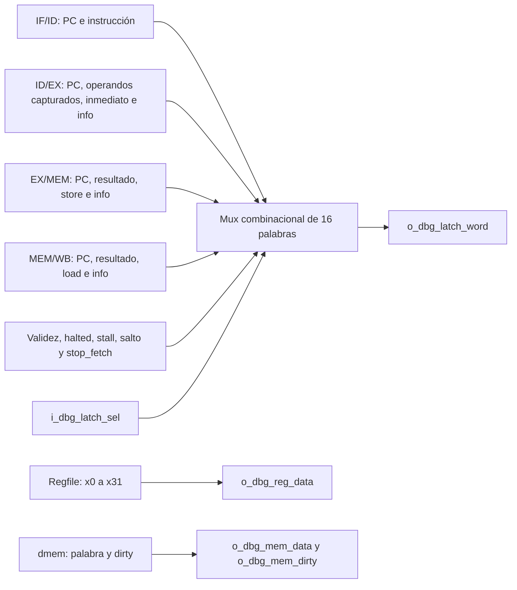

# Mapa debug del CPU real

Implementación A-30, 2026-11-09. Este documento relaciona los puertos y registros reales de A con el [contrato de dump v1 de B](../../../../TPs-companion/TP3_FINAL/doc/documentation/dump.md), consultado en el commit `f9dc09297f5bdcec6fb09048c003dbb6cd2188c0`. Conserva su layout; no sustituye la especificación de serialización ni acredita una aprobación conjunta nueva. La [evidencia A-30](../validation/A-30.md) registra las verificaciones locales.

## Lectura del estado

Los puertos debug son combinacionales y no escriben estado. `o_dbg_reg_data` muestra x0…x31 mediante `i_dbg_reg_addr`; x0 siempre devuelve cero. Las lecturas debug del regfile muestran el almacenamiento, sin el bypass WB→ID de los operandos de ejecución. `o_dbg_pc` muestra `r_pc_if`, dirección completa en bytes.

El mux está en `rtl/cpu.v`, con `casez`, default cero y rechazo previo de selectores con X/Z. No agrega registros ni depende de `valid` para ocultar datos. Los cuatro módulos de pipeline generan `info` con conexiones combinacionales a sus registros; A-30 conserva ese empaquetado ya existente.

## Selectores de latches

| Selector | Señal real | Procedencia |
|---|---|---|
| 0 | `w_pc_id` | IF/ID |
| 1 | `w_instr_id` | IF/ID |
| 2 | `w_pc_ex` | ID/EX |
| 3 | `w_rs1_data_ex` | Operando capturado en ID/EX |
| 4 | `w_rs2_data_ex` | Operando capturado en ID/EX |
| 5 | `w_imm_ex` | ID/EX |
| 6 | `w_info_ex` | `u_decode.u_id_ex.o_info` |
| 7 | `w_pc_mem` | EX/MEM |
| 8 | `w_result_mem` | EX/MEM |
| 9 | `w_store_data_mem` | EX/MEM, dato después de forwarding |
| 10 | `w_info_mem` | `u_execute.u_ex_mem.o_info` |
| 11 | `w_pc_wb` | MEM/WB; PC canónico de HALT |
| 12 | `w_result_wb` | MEM/WB |
| 13 | `w_load_data_wb` | MEM/WB |
| 14 | `w_info_wb` | `u_memory.u_mem_wb.o_info` |
| 15 | `w_dbg_flags` | Condiciones actuales del CPU |

Los selectores 3 y 4 no muestran `w_rs1_fwd_ex` ni `w_rs2_fwd_ex`. En el programa de prueba, `add x2,x1,x1` captura operandos cero y recibe 9 por ambos caminos de forwarding; el dump conserva los ceros capturados. El selector 9 sí muestra el dato reenviado que se capturó para el store.

## Palabras info

| Bits | Campo | EX | MEM | WB |
|---|---|---|---|---|
| 4:0 | rd | Sí | Sí | Sí |
| 9:5 | rs1 | Sí | 0 | 0 |
| 14:10 | rs2 | Sí | 0 | 0 |
| 17:15 | funct3 | Sí | Sí | 0 |
| 21:18 | alu_op | Sí | 0 | 0 |
| 22 | alu_src_b | Sí | 0 | 0 |
| 23 | mem_read | Sí | Sí | 0 |
| 24 | mem_write | Sí | Sí | 0 |
| 25 | mem_to_reg | Sí | Sí | Sí |
| 26 | reg_write | Sí | Sí | Sí |
| 27 | branch | Sí | 0 | 0 |
| 28 | jump | Sí | 0 | 0 |
| 29 | jalr | Sí | 0 | 0 |
| 30 | lui | Sí | 0 | 0 |
| 31 | halt | Sí | Sí | Sí |

Las máscaras de campos permitidos son EX=`FFFFFFFF`, MEM=`8783801F` y WB=`8600001F`. Los códigos de ALU proceden de `riscv_defs.vh`. El patrón sintético rd=5, reg_write=1 y halt=1 produce `84000005` en las tres etapas; solo sirve para verificar posiciones, sin representar una instrucción ejecutable.

Una burbuja anula validez y controles, pero puede conservar PC, operandos y campos de identificación según la política de A-12. Debug expone esos registros sin normalizarlos a cero por estar inválidos. Los campos que una etapa no transporta siempre salen cero.

## Flags del selector 15

| Bit | Señal real |
|---|---|
| 0 | `w_valid_id` |
| 1 | `w_valid_ex` |
| 2 | `w_valid_mem` |
| 3 | `w_valid_wb` |
| 4 | `o_halted` |
| 5 | `w_load_use_stall` |
| 6 | `w_take_ex` |
| 7 | `w_stop_fetch` |
| 31:8 | Cero |

Los bits 5 y 6 reflejan condiciones combinacionales del ciclo, incluso durante pausa. No registran eventos anteriores. `w_stop_fetch` vale `!w_take_ex && (r_fetch_stopped || w_halt_accept_id)`. La aceptación de HALT requiere reset inactivo, enable, CPU activo, HALT válido en ID y ausencia de salto o riesgo load-use.

Por eso, con HALT en ID antes de su aceptación, pasar `i_en` de 1 a 0 puede apagar el bit 7 sin cambiar ningún flop. Después de aceptar HALT, `r_fetch_stopped` conserva la detención. El estado final real tiene solo HALT válido en WB y flags `00000098`. Un arnés que mantenga `stop_fetch=0` con HALT válido en WB produce `00000018`.

## Memoria y serialización

`i_dbg_mem_addr` es un índice de palabra de 8 bits. `o_dbg_mem_dirty` informa el bit dirty y `o_dbg_mem_data` devuelve cero para una palabra limpia. El acceso no modifica memoria ni dirty.

La Debug Unit de B serializa registros en W3…W34 y las 16 palabras de latch en W35…W50, con W51 para la cantidad de palabras dirty. El formato sigue siendo little-endian, de `210+8M` bytes. El PC canónico de una parada HALT proviene del selector 11, aunque `o_dbg_pc` ya apunte después de HALT. En la prueba A-30, esos PC son 72 y 76 respectivamente.

La [verificación A-31](interfaz_cpu.md#interfaz-pública-verificada-en-a-31) comprueba los puertos y el barrido completo del estado público con CPU real y stub. La integración con Debug Unit y UART corresponde a A-32. El informe de cierre de M08 se generará al completar A-33.
