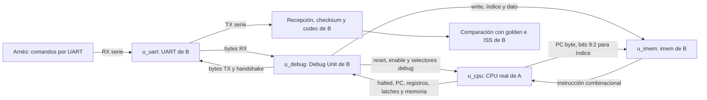
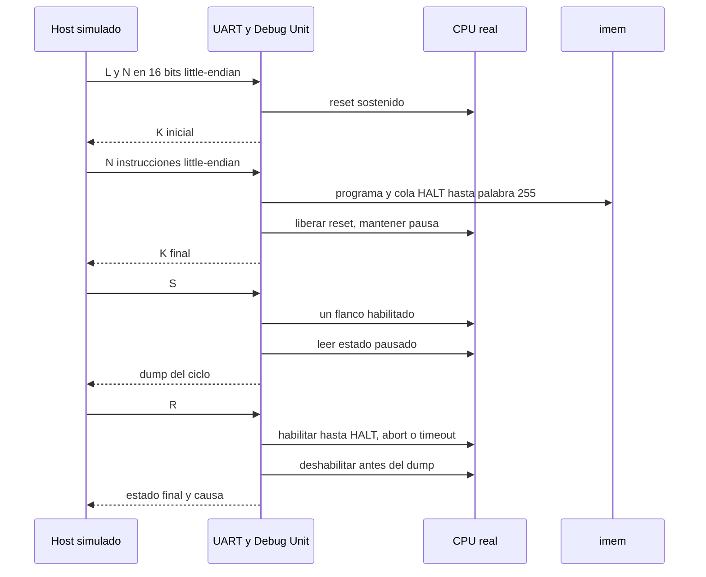

# Integración del CPU real con Debug Unit y UART

> Nota de reorganización: este documento conserva evidencia y comandos históricos. Los helpers `check_*` de A se retiraron y ya no se usa `--companion`; las rutas y comandos vigentes están en [organización del proyecto](organizacion.md).

Implementación A-32, 2026-11-09. El CPU de A se integra con el `system.v` original de B, consultado desde `Practico/TPs-companion`, commit `f9dc09297f5bdcec6fb09048c003dbb6cd2188c0`. La selección del CPU real ya existía: basta compilar sin `CPU_STUB` y aportar las fuentes del CPU. No se copiaron módulos ni se cambiaron los comandos, puertos o formato de dump.

La [evidencia A-32](../validation/A-32.md) registra las pruebas. Los contratos de [protocolo](protocolo.md), [dump](dump.md) e [interfaz](interfaz_cpu.md) de B conservan su contenido y estado documental; esta integración no atribuye una aprobación conjunta nueva.

## Estructura y propiedad de los módulos



Los cuatro módulos comparten un clock. `w_cpu_reset = i_reset | w_dbg_cpu_rst`. La pausa y el paso usan enable; no se generan relojes derivados. Las instancias de B conservan sus nombres `u_uart`, `u_debug`, `u_cpu` y `u_imem`.

`tools/tbs.py` define `CPU_FILES` para las fuentes de A y `SYSTEM_FILES` para UART, Debug Unit, imem y system de B. El target `tb_system_cpu_smoke` combina ambas listas y añade la BFM original `tb/common/uart_bfm.svh` como dependencia externa. Todo archivo de B se lee desde `--companion`; sus fuentes y vectores no se incorporan a la rama de A.

## Secuencia de control



LOAD escribe exactamente 256 palabras entre programa y relleno, con CPU en reset durante cada escritura. La longitud N determina cuántas palabras se reciben por UART; el resto se rellena con HALT. Un segundo programa corto reemplaza también la cola del primero. El comando X produce un único ciclo de reset CPU y conserva imem.

S significa un ciclo de pipeline, no una instrucción retirada. D lee sin habilitar ejecución. Un STEP sobre CPU halted puede pulsar enable, pero no aumenta los avances ni el contador W1; RUN sobre CPU halted responde sin habilitarlo.

## Banco de integración

[`tb_system_cpu_smoke.sv`](../../VIVADO/TP_FINAL/tb/system/tb_system_cpu_smoke.sv) maneja el sistema por la línea serie. Reutiliza las tareas de transmisión y recepción de la BFM de B. La inspección jerárquica se usa únicamente para observar el CPU y verificar la imagen de imem; no se fuerzan señales ni se escriben registros internos.

El banco recibe 34 dumps reales. Para cada uno comprueba cabecera, longitud `210+8M`, checksum, versión y causa; compara los 32 registros y 16 latches serializados con un snapshot del CPU pausado, y todos los pares de memoria con sus palabras dirty, en orden ascendente y con direcciones byte. Verifica que las 563 palabras observables permanezcan estables durante la respuesta y que no se envíen bytes extra después del checksum.

Un monitor toma reset/enable/halted fuera del flanco activo y cuenta los avances en el siguiente flanco. W1 se compara con ese contador independiente del registro interno de Debug Unit. Durante LOAD, cada escritura de imem exige reset CPU y ausencia de enable.

| Escenario | Comprobación principal |
|---|---|
| V | Respuesta exacta `56 01 00 01 00 01`. |
| L de `branch_load_use` | 35 palabras recibidas y cola HALT; D inicial con estado lógico cero. |
| Diez S, cada uno seguido por D | Un flanco habilitado por paso, W1=1…10 y dump D idéntico al del paso anterior. |
| Paso 7 y paso 9 | Dump pausado con load-use y salto tomado, respectivamente. |
| R del programa parcial | 43 avances acumulados, PC HALT=136 y estado completo igual al golden/ISS. |
| D/S/R después de HALT | Dumps idénticos, sin avances efectivos adicionales. |
| X y nueva ejecución | Un reset CPU; programa conservado; estado inicial cero; se reproduce el resultado final. |
| Recarga `suma` | N=9 reemplaza el programa anterior y su cola; 57 avances, x1=55 y memoria[0]=55. |
| `no_halt` con R y A | Debug Unit aborta antes del límite; halted=0 y causa aborted, sin confundirlo con HALT. |
| Dos R hasta timeout | 1000 avances por corrida, W1 acumulado de 1000 y 2000. |
| S después del timeout | Se limpian las causas anteriores y W1 pasa a 2001. |
| Recarga `flush_halt` | N=7; se descarta un HALT del camino incorrecto; se recupera ejecución normal en 10 avances. |

Los programas y estados independientes provienen de `TP3_FINAL/programs` y de la suite de A-29. Las cargas usan el prefijo ejecutable necesario; para `no_halt` se carga un único JAL a sí mismo. El contenido de imem después de cada LOAD y de X se verifica por las 256 palabras.

## Comparación con software de B

[`check_system_dumps.py` (helper retirado)](organizacion.md#herramientas-y-bancos-que-se-conservan) lee los bytes recibidos y utiliza directamente `host.dump.decode`, `encode` y `host.canonical` de B. Valida los 34 frames, round-trip exacto, rechazo de checksum alterado, equivalencia S/D y condiciones de reset/abort/timeout.

El helper compila el ISS original de B en build de A y compara PC de HALT, los 32 registros y memoria/dirty de `branch_load_use`, `suma` y `flush_halt`. También contrasta el golden independiente de A-29 y sus avances de pipeline. El ISS de `no_halt` debe alcanzar su límite de instrucciones, pero esa igualdad de causa no sustituye la comprobación del estado parcial: el banco y el helper exigen registros cero, memoria sin stores y halted=0 para ese programa.

## Ejecución y Vivado

Desde `Practico/TPs`:

```bash
python3 TP3_FINAL/tools/run.py tb tb_system_cpu_smoke --companion ../TPs-companion
python3 TP3_FINAL/tools/check_system_dumps.py --companion ../TPs-companion
```

El primer comando guarda tramas `build/a32_<caso>.dump.hex` y el intercambio UART en `build/a32_uart.bytes.log`. El segundo guarda resultados canónicos UART/ISS y falla con salida no nula ante una diferencia. No regenera programas ni expectativas.

El TB acepta `+ROOT=<raíz con barra final>` para localizar programas desde otro directorio y `+OUT=<directorio existente con barra final>` para separar las salidas. Si se simula con los hex presentes localmente, usa esos nombres como fallback. `+FAIL_FAST` termina en la primera discrepancia.

El `.xpr` registra el TB, UART/Debug Unit/system de B y la BFM como fuentes de simulación, con sus include paths. Para simularlo en Vivado, seleccionar `tb_system_cpu_smoke`, retirar cualquier definición `CPU_STUB` del fileset y ejecutar hasta `$finish` con `run all`: la prueba completa ocupa aproximadamente 50,2 ms de simulación. Usa clock de 50 MHz, baud acelerado de 1.562.500, `BYTE_TIMEOUT=20000` y `RUN_TIMEOUT=1000`; son parámetros del banco, sin modificar los valores de placa de B.

## Alcance del cierre

A-32 verifica integración funcional inicial con CPU real y conserva el banco de B con stub. No cierra la aceptación compartida AB-05 ni valida FPGA, timing implementado o todas las variantes de error del protocolo. A-33 completó la regresión final del datapath y el cierre local de A-M08; el [informe 08](08_cpu_listo_para_debug.md) y su [gate](../validation/A-M08.md) reúnen estructura, diagramas, comandos y resultados.
