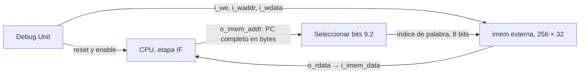

# Integración CPU–memoria de instrucciones

Este documento fija la conexión que usará la etapa IF del CPU y registra la verificación A-08. La interfaz pública procede de B-08 y la implementación actual de `imem` de B-09 se consulta en el worktree `Practico/TPs-companion`. A-08 no incorpora esos archivos a la rama de A.



## Propiedad de las señales

| Señal o estado | Responsable | Regla |
|---|---|---|
| PC de IF | CPU de A | Registro de 32 bits en bytes; `o_imem_addr` y `o_dbg_pc` exponen el PC completo. El reset CPU lo lleva a cero. |
| `i_imem_data` | `imem` de B por medio de `system.v` | Lectura combinacional de `o_imem_addr[9:2]`; IF captura esa palabra cuando el CPU avanza. |
| Array de 256 palabras | `rtl/debug/imem.v` de B | Una sola instancia externa al CPU (`u_imem` en `system.v`), inicializada en HALT para simulación. |
| Escritura de programa | Debug Unit de B | `i_we`, `i_waddr[7:0]` e `i_wdata[31:0]` llegan a `u_imem`; el CPU no tiene puerto de escritura de instrucciones. |
| Reset durante `LOAD` | Debug Unit y `system.v` de B | `w_cpu_reset = i_reset | w_dbg_cpu_rst`; `LOAD` mantiene el reset del CPU mientras carga y completa el programa. `imem` no tiene entrada de reset. |

El índice toma solo los bits `[9:2]`. Por eso los PC byte 0, 4 y 1020 leen las palabras 0, 1 y 255; 1024 y 1028 vuelven a 0 y 1, y la dirección 2 también selecciona 0. El CPU conserva los 32 bits del PC para saltos, `PC+4` y debug. No se divide dos veces ni se reemplaza el PC por el índice.

La escritura aislada con CPU pausado modifica solamente la palabra de `imem` elegida. En el comando `LOAD`, además de escribir `imem`, la Debug Unit mantiene el CPU en reset; son situaciones distintas. En ambos casos el contenido de `imem` sobrevive al reset CPU. La inicialización de las 256 palabras con HALT está verificada en simulación; su comportamiento físico en FPGA se comprobará en AB-06.

## Implementación y pruebas disponibles

El `cpu_ports.vh` de B-08 define `o_imem_addr[31:0]` e `i_imem_data[31:0]`. El `system.v` de B conecta `u_cpu.o_imem_addr` a `u_imem.i_raddr(w_imem_addr[9:2])`, y `u_imem.o_rdata` a `u_cpu.i_imem_data`. El mismo `system.v` conecta la escritura de la Debug Unit a `u_imem`. El stub de B-09 usa los puertos públicos y genera PC en bytes, pero **no ejecuta instrucciones** ni consume semánticamente `i_imem_data`.

El testbench de A-08, `tb_imem_bridge.sv`, comprueba el cableado de dirección y la independencia entre reset CPU e `imem` usando `cpu_stub.v` e `imem.v` originales desde el worktree de B. El runner de A acepta `--companion PATH` para `tb_imem` y `tb_imem_bridge`; `tbs` sigue ejecutando solo las pruebas locales de A, de modo que una copia sin el worktree de B sigue siendo verificable.

Desde `Practico/TPs`:

```bash
python3 TP3_FINAL/tools/run.py tb tb_imem --companion ../TPs-companion
python3 TP3_FINAL/tools/run.py tb tb_imem_bridge --companion ../TPs-companion
```

El primer CPU real y la captura de `i_imem_data` en IF/ID se implementarán y verificarán en A-13. A-08 establece y prueba la interfaz hasta ese límite.
