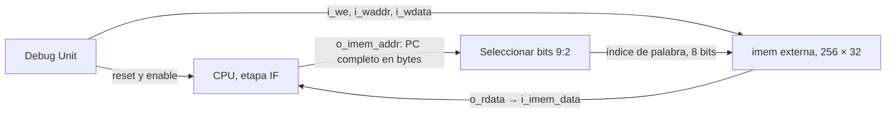
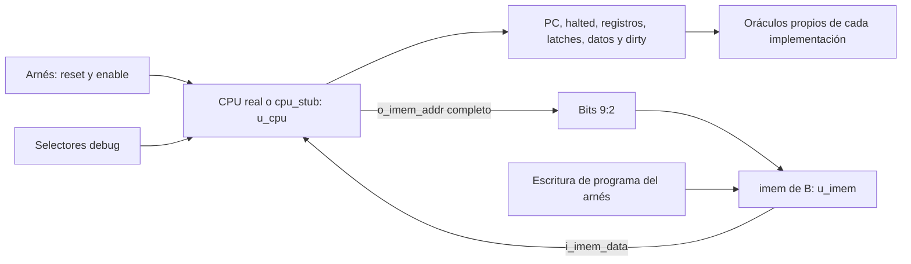

# Integración CPU–memoria de instrucciones

Este documento fija la conexión que usará la etapa IF del CPU y registra la verificación A-08. La interfaz pública procede de B-08 y la implementación actual de `imem` de B-09 se consulta en el worktree `Practico/TPs-companion`. A-08 no incorpora esos archivos a la rama de A.



## Propiedad de las señales

| Señal o estado | Responsable | Regla |
|---|---|---|
| PC de IF | CPU de A | Registro de 32 bits en bytes; `o_imem_addr` y `o_dbg_pc` exponen el PC completo. El reset CPU lo lleva a cero. |
| `i_imem_data` | `imem` de B por medio de `system.v` | Lectura combinacional de `o_imem_addr[9:2]`; IF captura esa palabra cuando el CPU avanza. |
| Array de 256 palabras | `rtl/debug/imem.v` de B | Una sola instancia externa al CPU (`u_imem` en `system.v`), inicializada en HALT para simulación. |
| Escritura de programa | Debug Unit de B | `i_we`, `i_waddr[7:0]` e `i_wdata[31:0]` llegan a `u_imem`; el CPU no tiene puerto de escritura de instrucciones. |
| Reset durante `LOAD` | Debug Unit y `system.v` de B | `w_cpu_reset = i_reset | w_dbg_cpu_rst`; `LOAD` mantiene el reset del CPU mientras carga y completa el programa. `imem` no tiene entrada de reset. |

El índice toma solo los bits `[9:2]`. Por eso los PC byte 0, 4 y 1020 leen las palabras 0, 1 y 255; 1024 y 1028 vuelven a 0 y 1, y la dirección 2 también selecciona 0. El CPU conserva los 32 bits del PC para saltos, `PC+4` y debug. No se divide dos veces ni se reemplaza el PC por el índice.

La escritura aislada con CPU pausado modifica solamente la palabra de `imem` elegida. En el comando `LOAD`, además de escribir `imem`, la Debug Unit mantiene el CPU en reset; son situaciones distintas. En ambos casos el contenido de `imem` sobrevive al reset CPU. La inicialización de las 256 palabras con HALT está verificada en simulación; su comportamiento físico en FPGA se comprobará en AB-06.

## Implementación y pruebas disponibles

El `cpu_ports.vh` de B-08 define `o_imem_addr[31:0]` e `i_imem_data[31:0]`. El `system.v` de B conecta `u_cpu.o_imem_addr` a `u_imem.i_raddr(w_imem_addr[9:2])`, y `u_imem.o_rdata` a `u_cpu.i_imem_data`. El mismo `system.v` conecta la escritura de la Debug Unit a `u_imem`. El stub de B-09 usa los puertos públicos y genera PC en bytes, pero **no ejecuta instrucciones** ni consume semánticamente `i_imem_data`.

El testbench de A-08, `tb_imem_bridge.sv`, comprueba el cableado de dirección y la independencia entre reset CPU e `imem` usando `cpu_stub.v` e `imem.v` originales desde el worktree de B. El runner de A acepta `--companion PATH` para `tb_imem` y `tb_imem_bridge`; `tbs` sigue ejecutando solo las pruebas locales de A, de modo que una copia sin el worktree de B sigue siendo verificable.

Desde `Practico/TPs`:

```bash
python3 TP3_FINAL/tools/run.py tb tb_imem --companion ../TPs-companion
python3 TP3_FINAL/tools/run.py tb tb_imem_bridge --companion ../TPs-companion
```

La captura real de `i_imem_data` en IF/ID se implementó en A-13. La verificación A-31 que sigue comprueba la sustitución del stub por el CPU actual con el mismo cableado público.

## Interfaz pública verificada en A-31

El [auditor de interfaz](../../tools/check_cpu_contract.py) comprueba los 14 puertos contra `cpu_ports.vh` y contra la declaración documentada por B en `interfaz_cpu.md`. Verifica que `cpu.v` y `cpu_stub.v` incluyan ese encabezado como su única declaración de puertos, sin adaptadores. También compara las dos listas de conexiones de `u_cpu` en `system.v` de B.

| Puerto | Dirección desde CPU | Bits |
|---|---|---:|
| `i_clock`, `i_reset`, `i_en` | Entrada | 1 cada uno |
| `o_halted` | Salida | 1 |
| `o_imem_addr` | Salida | 32 |
| `i_imem_data` | Entrada | 32 |
| `i_dbg_reg_addr` | Entrada | 5 |
| `o_dbg_reg_data` | Salida | 32 |
| `i_dbg_latch_sel` | Entrada | 4 |
| `o_dbg_latch_word` | Salida | 32 |
| `i_dbg_mem_addr` | Entrada | 8 |
| `o_dbg_mem_data` | Salida | 32 |
| `o_dbg_mem_dirty` | Salida | 1 |
| `o_dbg_pc` | Salida | 32 |

El [arnés `tb_cpu_contract.sv`](../../VIVADO/TP_FINAL/tb/tb_cpu_contract.sv) selecciona CPU real o stub mediante `CPU_STUB`, con una única lista de conexiones y una instancia `u_cpu` en ambos casos. Instancia la `imem` original de B como `u_imem`. Solo consulta puertos públicos del CPU; la inspección del array externo de imem sirve para comprobar la preservación de las 256 palabras del programa.



Los targets `tb_cpu_contract` y `tb_cpu_contract_stub` tienen listas de fuentes explícitas. El segundo define `CPU_STUB=1` y no compila el CPU real. El runner ahora acepta el diccionario `defines` de cada entrada y pasa sus valores a Icarus con `-D`. Los artefactos y logs permanecen en `TP3_FINAL/build` de A; no se copian carpetas de B.

### Casos con CPU real

Se recorre el estado público completo durante pausa: 32 registros, 16 latches y 256 pares dirty/dato, más PC, dirección de instrucciones y halted. Se repite el barrido sin flancos y después de clocks con enable cero. Las lecturas deben responder a cada selector sin modificar el snapshot.

El primer programa escribe las 256 palabras de dmem: el índice n contiene n+1, salvo el último, que se sobrescribe con cero y conserva dirty=1. Luego asigna x1…x31 valores distintos, `17×índice+1`, para detectar truncamientos del selector de registros. La escritura de una palabra no ejecutada de imem con CPU detenido tampoco modifica su snapshot público.

Reset con enable cero limpia registros, validez y dirty, dejando intacto el programa. El segundo programa hace SB y SH sobre memoria lógicamente limpia que conserva datos físicos de la ejecución anterior: verifica que la mezcla parta de cero. Comprueba palabras 0, 4, 127, 128 y 255, SW desalineado, wrap en dirección 1040, store de cero con dirty y un load de palabra limpia. Los índices restantes siguen limpios y se leen como cero.

El tercer programa salta a PC byte 1032, que selecciona la palabra 2 de imem. HALT queda en PC WB=1036 y PC IF=1040. Así se distingue la dirección completa del índice de palabra de ocho bits.

### Casos con stub

El mismo barrido usa sus fórmulas sintéticas: xi=`ciclos×256+i`, latches con base `1A000000` y dirty solo en 4, 16 y 63 cuando hay avances. El stub se detiene en su ciclo 20. Sus valores tras reset no se utilizan como expectativas del CPU real. También se comprueban reset durante pausa, freeze y preservación de imem, aunque el stub ignore las instrucciones.

Desde `Practico/TPs`:

```bash
python3 TP3_FINAL/tools/check_cpu_contract.py --companion ../TPs-companion
python3 TP3_FINAL/tools/run.py tb tb_cpu_contract --companion ../TPs-companion
python3 TP3_FINAL/tools/run.py tb tb_cpu_contract_stub --companion ../TPs-companion
```

En Vivado, el arnés y `cpu_stub.v` externo están registrados en `sim_1`. Seleccionar `tb_cpu_contract` como top de simulación; sin `CPU_STUB` se usa CPU real, y agregando `CPU_STUB=1` a las definiciones del fileset se usa stub. Para volver al CPU real hay que retirar esa definición. No se modifica la parte FPGA preexistente del proyecto.

La [evidencia A-31](../validation/A-31.md) registra simulación en Icarus/XSim y elaboración del `system.v` original de B en ambas variantes. No se cambiaron puertos ni contratos de B. La [integración funcional A-32](integracion_debug.md) agrega la carga y ejecución por UART, los dumps de pasos/pausas y la comparación con el codec e ISS de B; la elaboración de A-31 por sí sola no certifica esa comunicación.

El [cierre local A-M08](08_cpu_listo_para_debug.md) vuelve a verificar este contrato dentro de la regresión final A-33, con los mismos puertos y fuentes originales de B.
