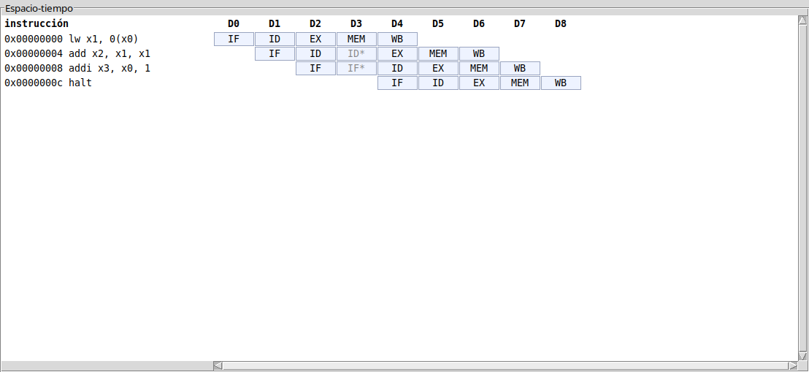
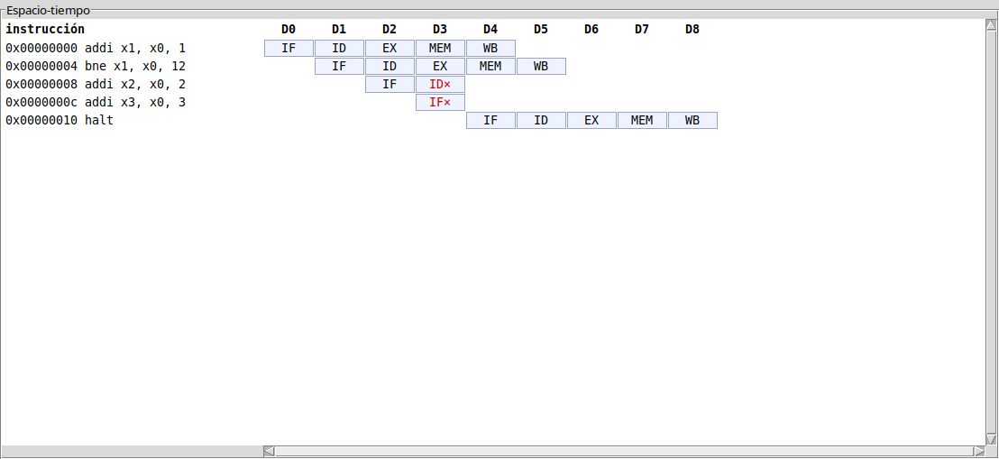

# Manual de la interfaz gráfica

Ventana de depuración del CPU RISC-V: carga un programa, lo ejecuta paso a paso o de corrido y muestra registros, pipeline, latches, memoria y el diagrama espacio-tiempo, comparando contra el golden model (el ISS).

> **Las capturas de este manual son con `--fake`** (placa simulada sobre el ISS, sin placa ni CPU de A). Con `--fake` el diagrama espacio-tiempo es **una demo**: la placa simulada solo llena los latches 11 (WB), 14 y 15, así que solo se ven las columnas `IF` y `WB` (con `WB` en `pc = 0` mientras el programa corre). El diagrama real, con las cinco etapas, el stall y las anuladas, aparece con el CPU de A (Fases 10 y 11); hasta entonces ese criterio de B-26 queda abierto. Las dos capturas de la sección 5 están hechas con dumps armados a mano (los escenarios de `tests/test_spacetime.py`), no con la placa.

La [guía de integración y Basys3](09_integracion_cpu_debug_basys3.md) contiene el proyecto y bitstream del CPU real ya implementado; la prueba física de la interfaz con esa placa queda pendiente. Las capturas siguientes conservan su carácter de demostración con FakeBoard.

## 1. Cómo abrir

Desde `TP3_FINAL/sw`:

```
py -m host.gui --fake                          # placa simulada (necesita build/iss.exe)
py -m host.gui --port COM7                     # placa real
py -m host.gui --fake --iss <ruta a iss.exe>   # ISS en otra ruta (default ../build/iss.exe)
py -m host.gui --fake --fake-fault x5=0xdead   # solo para probar la marca roja
```

Si falta `build/iss.exe`: `py TP3_FINAL/tools/run.py iss`. Con `--fake` es obligatorio (error y código 2); con `--port` la ventana abre igual, sin comparación, y la barra de abajo avisa `sin golden: falta ...`. `--fake-fault` se puede repetir y solo vale con `--fake`.

## 2. La ventana


Captura con `--fake`: `suma.s`, 10 pasos. `x1` en amarillo porque cambió en el último paso.

### Barra superior


| Control | Qué hace |
| --- | --- |
| `Cargar .s…` | Elige un `.s` (se ensambla) o un `.hex`, lo carga y borra el diagrama |
| `Reset` | Reinicia el CPU (mismo programa) y borra el diagrama |
| `Paso` | Un ciclo; agrega una columna al diagrama |
| `Paso ×N` | N ciclos seguidos (1 a 100, el número del cuadro de al lado); agrega N columnas |
| `Ejecutar` | Corre hasta `HALT`, límite de tiempo o `A` (abort); agrega **una sola** columna |
| `Dump` | Vuelve a leer el estado sin avanzar el CPU; no agrega columna |
| Estado | `ciclos=… pc=…` y, si corresponde, `halted`, `timeout` o `abort` |

Con el CPU ya detenido (`halted`), `Paso`, `Ejecutar` y `Dump` no agregan columnas. Un error de la placa (o un `.s` con errores) sale en una ventana de aviso y la interfaz sigue funcionando.

### Registros


Grilla de 8 × 4 (`x0` a `x31`, cuatro por fila), igual que el comando `regs` de la CLI. Amarillo: cambió respecto del dump anterior. Rojo: difiere del golden model (ver la sección 6).

### Pipeline


Las mismas cinco líneas que el comando `pipe`: `IF`, `ID`, `EX`, `MEM`, `WB`, con el `pc` y la instrucción desensamblada, o `--` si la etapa no tiene instrucción válida.

### Latches


Por cada latch (`ID/EX`, `EX/MEM`, `MEM/WB`): las palabras crudas en hex y los campos decodificados de su palabra de info, **solo los que ese latch lleva** (`ID/EX` todos; `EX/MEM`: `rd`, `funct3`, `mem_read`, `mem_write`, `mem_to_reg`, `reg_write`, `halt`; `MEM/WB`: `rd`, `mem_to_reg`, `reg_write`, `halt`; ver `dump.md` §3.1). `rs1_val` y `rs2_val` son los **valores** leídos del banco, no los índices.

### Memoria


Los pares `dirección: dato` de las palabras de datos escritas (los "sucios" del dump). Rojo: distinta del golden model. Sin escrituras muestra `(sin palabras escritas)`.

### Espacio-tiempo


Una fila por instrucción dinámica y una columna por dump (`D0` = estado tras cargar o resetear). Tiene scroll horizontal (la vista salta a la última columna) y vertical. Cómo leerlo, en la sección 5.

## 3. Flujo típico

1. Abrir la ventana (`--fake` o `--port`).
2. `Cargar .s…` y elegir, por ejemplo, `TP3_FINAL/programs/suma.s`. El estado es `ciclos=0` y el diagrama tiene la columna `D0`.
3. Paso a paso: `Paso` (o `Paso ×N`). Mirar lo que se pone en amarillo, el pipeline y el diagrama.
4. De corrido: `Ejecutar`. Para `suma.s`: `halted`, `x1 = 0x00000037` y la memoria `0x00000000: 0x00000037`.


5. Repetir: `Reset` (mismo programa, de cero) o `Cargar .s…` de nuevo (programa nuevo; reprograma la `imem`). Los dos borran el diagrama.

## 4. Barra de abajo (comparación con el golden model)

| Texto | Significa |
| --- | --- |
| `golden: ok` | El estado coincide con el ISS |
| `golden: N divergencias: x5, mem[0x00000008], …` | N claves distintas (se listan las primeras 8, en orden alfabético) |
| `sin comparar (timeout)` / `sin comparar (abortado)` | Tras `Ejecutar` que no llegó a `HALT`: el estado intermedio no tiene un punto equivalente en el ISS |
| `sin comparar (tras Ejecutar)` | Después de un `Ejecutar` ya no se sabe cuántas instrucciones se retiraron: solo se compara el estado final (`halted`) |
| `sin golden` | No hay `iss.exe` (solo con `--port`) |

Paso a paso se compara con el ISS tras `r(n)` instrucciones retiradas: los dumps `D0 … D(n−1)` con `WB` válido y sin `halt` (la instrucción que está en `WB` en un dump escribe en el flanco del paso siguiente). Tras `Ejecutar` con `halted` se compara contra el estado final del ISS.

## 5. Cómo leer el diagrama

Cada celda dice en qué etapa estaba esa instrucción en ese dump: `IF`, `ID`, `EX`, `MEM`, `WB`. Las celdas con marca:

| Marca | Color | Significa |
| --- | --- | --- |
| `ID*`, `IF*` | gris | La instrucción **se quedó** en esa etapa porque hubo un stall de load-use (`load_use_stall` del dump anterior) |
| `ID×`, `IF×` | rojo | La instrucción fue **anulada**: se cargó pero no llegó a ejecutarse (el salto o `jal`/`jalr` tomado en `EX` anula las dos de atrás, o el fin de captura tras `HALT`) |

Una columna sin celda en `EX`/`MEM` es una burbuja.

**Load-use** (`lw x1, 0(x0)` seguido de `add x2, x1, x1`): el `add` se queda un ciclo de más en `ID` (`ID*`) y la siguiente en `IF` (`IF*`).



**Salto tomado** (`bne` tomado): las dos instrucciones de atrás terminan en `×` y la que sigue es la del destino.



## 6. La marca roja

Un registro en rojo (o una palabra de memoria en rojo) es una **divergencia**: el valor de la placa no es el que calcula el ISS para ese punto del programa. La marca roja gana sobre el amarillo. Para verla sin una falla real, con la placa simulada:

```
py -m host.gui --fake --fake-fault x5=0xdead
```

Cargar `TP3_FINAL/programs/branches.s`: `x5` queda en rojo desde la carga y en la barra de abajo se lee `golden: 1 divergencias: x5`.


## 7. Pruebas

`py -m pytest -q tests/test_spacetime.py tests/test_golden.py tests/test_gui_smoke.py` desde `TP3_FINAL/sw` (las dos primeras no necesitan pantalla). La prueba de humo de la GUI abre una ventana oculta; se saltea sola si no hay pantalla, o con `RV_SKIP_GUI=1`.

## 8. Regenerar las capturas

Las capturas de `img/` se regeneran con `py TP3_FINAL/tools/capture_manual.py [directorio de salida]` (por defecto `TP3_FINAL/doc/documentation/img`). Solo Windows, no necesita Pillow, requiere `build/iss.exe` y una pantalla activa; la ventana queda arriba de todo mientras corre y no hay que tocar el mouse.
